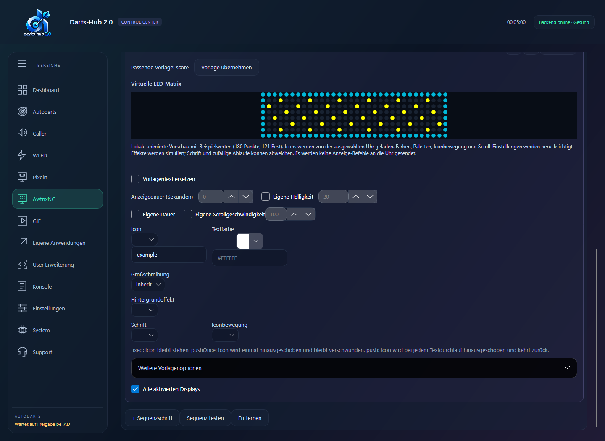
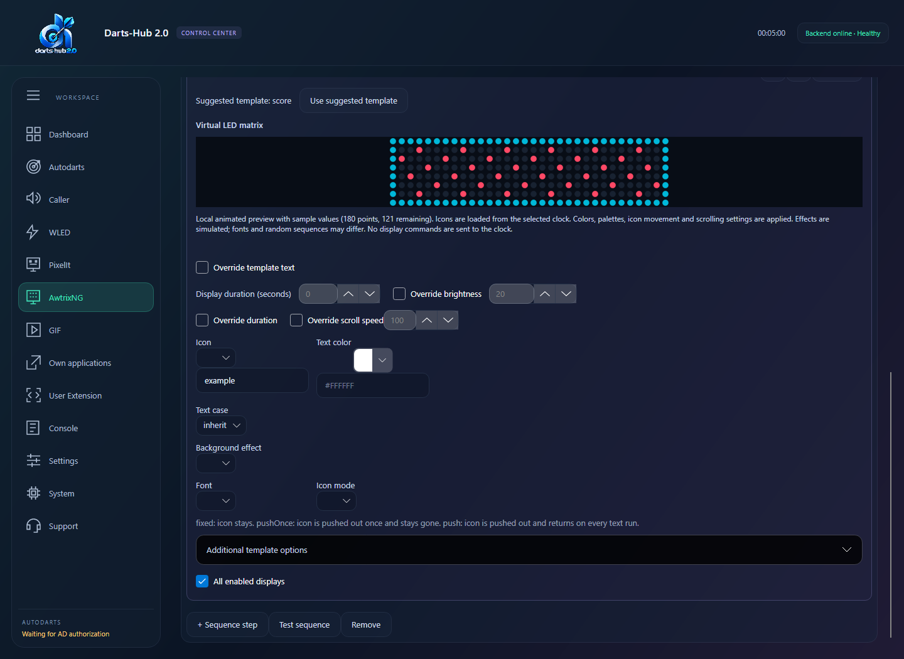

# AwtrixNG

## Deutsch

### Wiederherstellung nach Uhrenneustart
AWTRIX-NG hält gesendete Apps wie `darts_event` nur im Arbeitsspeicher. Nach einem Neustart können sie fehlen, obwohl ihr Name noch in der gespeicherten Reihenfolge steht. Darts-Hub stellt App-Reihenfolge, deaktivierte Apps, Einstellungen und Displayzustand wieder her und aktiviert die vorherige App nur, wenn sie noch verfügbar ist. Eine fehlende App blockiert die Wiederherstellung nicht. Das gilt gemeinsam für GUI, Weboberfläche und TUI; dort unter **AwtrixNG** das Gerät prüfen/neu laden. Neue Ereignisse senden ihre Anzeige erneut.

### GIF-Vorlage und HubX
Für Vollbild-Icons **gif** auswählen, **Vorlagentext ersetzen** ausschalten und ein auf dem Controller vorhandenes Icon wählen. Die Vorlage hat keinen Text und verwendet einen festen Icon-Modus. Für Vollbild eine **32×8-GIF-Datei** verwenden; kleine Icons werden nicht auf die volle Breite gestreckt. Die virtuelle Vorschau verändert den Controller nicht, **Testsequenz** dagegen sendet den Entwurf tatsächlich. Danach speichern.



Im HubX-Bereich Ereignisse entdecken, teilen und übernehmen. Mitgelieferte GIFs erscheinen zusätzlich einzeln. Einzelne GIFs werden nach Zielauswahl und Dateikonfliktprüfung auf den Controller geladen, ohne neue Regel. [HubX](HUBX.md) · [GIF-Verwaltung](AWTRIXNG_ICONS.md)

Voraussetzung: **AwtrixNG-Firmware** und verbundenes Board unter **Autodarts**. Der Caller darf ausgeschaltet sein.

1. **AwtrixNG → Geräte** öffnen, Erweiterung aktivieren und Display mit Adresse hinzufügen. Falls nötig, HTTP-Benutzer und Passwort eintragen.
2. Gerät mit **Prüfen / neu laden** prüfen.
3. Unter **Ereignisse** eine Regel anlegen: Auslöser wählen, bei Bedarf Spieler/Punktzahl einschränken.
4. Schritt hinzufügen, Vorlage und Zielgeräte wählen; Text, Icon und Dauer einstellen. `{score}` und `{playername}` setzen Spielwerte ein. Mehrere Schritte laufen nacheinander.
5. **Testen**, anschließend **Speichern**. Tests steuern das Display, speichern aber nichts.

- **Dauer** ist in Sekunden. Im automatischen Ausgabemodus bleibt bei Dauer **0** eine App aktiv; automatische App-Wechsel am Display können sie trotzdem ausblenden.
- **Display-Einstellungen:** Nur Werte aktivieren, die DartsHub auf dem Display ändern soll.
- **Gerätesteuerung:** Display ein/aus, Bildschirm wechseln. Löschen, Zurücksetzen und Firmware-Uploads nur bewusst verwenden.
- Ein leeres Passwortfeld behält das gespeicherte Passwort; zum Entfernen die entsprechende Option wählen.

TUI: Seite **AwtrixNG**, **Enter** zum Bearbeiten. Headless nutzt die gespeicherten Einstellungen; [Startargumente](START_ARGUMENTS.md).

## English

### Recovery after a clock restart
AWTRIX NG keeps pushed apps such as `darts_event` in memory. After a restart they may be missing even when their names remain in the saved order. Darts-Hub restores app order, disabled apps, settings and display state, and only activates the previous app if it is still available. A missing app does not block recovery. This shared behavior applies to GUI, web UI and TUI; use the device check/reload action under **AwtrixNG**. New events push their display again.

### GIF template and HubX
For fullscreen icons choose **gif**, disable custom text and select an installed controller icon. Use a **32×8 GIF**; smaller icons are not stretched. Virtual previews leave the controller unchanged; device tests send the draft. Save afterwards. Discover/share/import events from the module's HubX area. Included GIFs are also offered separately; standalone GIF imports upload to a selected controller after conflict review without creating a rule. [HubX](HUBX.md)



Requires **AwtrixNG firmware** and a connected board under **Autodarts**. Caller may stay disabled.

1. Open **AwtrixNG → Devices**, enable the extension and add the display address. Enter HTTP credentials if required.
2. Use **Check / reload** to check the device.
3. Under **Events**, add a rule with a trigger and optional player/score filter.
4. Add a step, select a template and target devices, then set text, icon and duration. `{score}` and `{playername}` insert game values. Steps run in order.
5. **Test**, then **Save**. Tests control the display but do not save settings.

- Duration is in seconds. In automatic output mode, **0** keeps an app active; automatic app switching can still hide it.
- Enable only **Display settings** you want DartsHub to change.
- **Device control** provides power, screen switching and stopping audio. Use deletion, reset and firmware uploads with care.
- An empty password field keeps the saved password; use the clear option to remove it.

TUI: **AwtrixNG**, **Enter** to edit. Headless uses saved settings; [startup arguments](START_ARGUMENTS.md).

### Live-Anzeige nach jedem Wurf (PixelIt und AwtrixNG)

**Eine Matrix für alle Spieler:** Lege zwei Regeln an: **Nach jedem Wurf** und **Spielerwechsel**. Lass den Spielerfilter leer und wähle in beiden Regeln dieselbe Matrix als Ziel. Aktiviere **Vorlagentext ersetzen** und trage z. B. ein:

```text
{playername} {points-left} D{dart-number}
```

Die Anzeige startet mit dem aktiven Spieler, aktualisiert sich nach jedem Wurf und wechselt beim Spielerwechsel automatisch. Bei PixelIt setze die Pause danach für eine schnelle Anzeige auf 0.

**Eine Matrix je Spieler:** Verwende dieselben Ereignisse und pro Matrix einen Text mit fester Spielernummer, etwa:

```text
{p1-playername} {p1-points-left} D{p1-darts-thrown}
```

Auf der zweiten Matrix ersetze `p1` durch `p2`, usw. Die Nummern bleiben gleich, auch wenn sich der Startspieler ändert. Lass den Spielerfilter leer, damit die Werte bei jedem Ereignis aktualisiert werden. Weise den Anzeigeschritt jeweils der gewünschten Matrix zu.

| Platzhalter | Bedeutung |
| --- | --- |
| `{dart-score}` | Punkte des letzten Darts |
| `{dart-number}` | Dartnummer in der aktuellen Aufnahme (0–3) |
| `{darts-thrown}` | Anzahl geworfener Darts im aktuellen Leg |
| `{turn-score}` | Punkte der aktuellen Aufnahme |
| `{points-left}` | Restpunkte des ausgewählten/aktiven Spielers |
| `{p1-points-left}`, `{p1-darts-thrown}` | Feste Werte von Spieler 1; ebenso für p2 bis p32 |

Korrekturen, Zurücknehmen und Überwerfen verwenden die von Autodarts gemeldeten Werte. In der TUI stehen dieselben Ereignisse und Textfelder zur Verfügung. Der Auslöser **Wurf oder Turnwechsel** aktualisiert eine Regel bei Würfen und neuen Aufnahmen, auch desselben Spielers. In der TUI unter Ereignisse → Auslöser auswählen; Headless-Konfigurationen verwenden `ThrowOrTurnChanged` (`PlayerChanged` bleibt der separate tatsächliche Spielerwechsel).


### Live display after each dart (PixelIt and AwtrixNG)

**One matrix for all players:** Create two rules: **After each dart** and **Player change**. Leave the player filter empty and target the same matrix in both rules. Enable **Replace template text** and enter, for example:

```text
{playername} {points-left} D{dart-number}
```

The display starts with the active player, updates after each dart and follows player changes. For a fast PixelIt display, set the pause after the step to 0.

**One matrix per player:** Use the same events and a fixed player number in each matrix's text, for example:

```text
{p1-playername} {p1-points-left} D{p1-darts-thrown}
```

Replace `p1` with `p2` on the second matrix, and so on. Numbers stay the same when the starting player changes. Leave the player filter empty to refresh values on every event. Target the appropriate matrix from each display step.

| Placeholder | Meaning |
| --- | --- |
| `{dart-score}` | Last dart score |
| `{dart-number}` | Dart number within the current visit (0–3) |
| `{darts-thrown}` | Darts thrown in the current leg |
| `{turn-score}` | Current visit score |
| `{points-left}` | Remaining score of the selected/active player |
| `{p1-points-left}`, `{p1-darts-thrown}` | Fixed values for player 1; likewise for p2 through p32 |

Corrections, undo and busts use the values reported by Autodarts. The TUI provides the same events and text fields. The **Throw or turn change** trigger updates on throws and new visits, including the same player. In the TUI, select it under Events → Trigger; headless configurations use `ThrowOrTurnChanged` (`PlayerChanged` remains the separate actual player change).


## Uhr-Diagnose / Clock diagnostics

GUI: Unter Geräte zeigt jede Karte Verbindung, optionale Zugangsdaten und einen eigenen Diagnosebereich. **Daten aktualisieren** liest den aktuellen Zustand des Controllers, ohne Einstellungen zu ändern. Je nach Firmware erscheinen Firmware, Geräte-IP, aktive Anzeige, Matrixstatus und Auflösung, Helligkeit, WLAN-Signal, Laufzeit, Bildrate und freier Speicher. Fehlende Angaben werden nicht als Nullwerte ergänzt. Der Zeitstempel bezieht sich auf die tatsächlich empfangenen Gerätedaten; ältere Werte bleiben bei einem fehlgeschlagenen Abruf sichtbar. Verbindungsfehler erscheinen im Gerätestatus.

TUI: Im AWTRIX-Menü **Uhrname · Daten aktualisieren** wählen. Die Diagnose erscheint als Textansicht. Im Browser steht derselbe Abruf unter Geräte zur Verfügung. Konfiguration und JSON-Import bleiben unverändert.

GUI: Each device card separates connection settings, optional authentication and clock diagnostics. **Refresh device data** reads the controller without changing its settings. Available readings depend on firmware; missing fields are omitted. The timestamp indicates when device data was received, and previous readings remain visible after failed requests. Connection errors appear in the device status.

TUI: Select **Clock name · Refresh device data** in the AWTRIX menu to open the diagnostic text view. The browser offers the same action under Devices. Configuration and legacy imports are unchanged.


### Aktuelle Werte in Einstellungsfeldern / Current values in setting fields

GUI: Im Reiter **Geräteeinstellungen** die Quelluhr wählen. Deren aktuelle Werte werden in alle nicht aktivierten Felder geladen. Vorhandene aktivierte Vorgaben und laufende Änderungen bleiben erhalten. Eine Einstellung aktivieren, den vorausgefüllten Wert ändern und speichern; nur aktivierte Einstellungen werden an alle aktiven Uhren übertragen. Nicht von der Firmware gelieferte oder ungültige Werte sind als nicht verfügbar gekennzeichnet. **Daten aktualisieren** lädt die Uhr erneut. Farben, Zahlen, Auswahlfelder, Schalter und Listen werden berücksichtigt, auch ausdrücklich leere Farbkorrekturen.

TUI: Eine Einstellungsgruppe öffnen und bei mehreren Uhren die Quelluhr auswählen. Nach dem Abruf zeigen Auswahl und Eingabe den Gerätewert, sofern keine aktivierte Vorgabe existiert. **Überschreiben** aktiviert den Wert; **Vom Gerät übernehmen** entfernt die Vorgabe. Im Browser wird die Quelluhr ebenfalls über den Einstellungsbereich gewählt. Ein reiner Abruf speichert keine Vorgaben und verändert weder Geräte noch Importdaten.

GUI/browser: Select a source clock in device settings. Current device values prefill inactive fields; enabled overrides remain untouched. Enable a setting, edit its prefilled value and save. Saving applies only enabled overrides to all enabled clocks. Missing or invalid firmware values are marked unavailable.

TUI: Open a settings group, select a source clock when prompted and edit the prefilled value. Reading values alone creates no overrides. Legacy imports remain unchanged.


## Exklusive Match-Steuerung / Exclusive match control

GUI: Unter **AWTRIX → Optionen** **Normale Uhr-Apps deaktivieren** auswählen und speichern. Zur Auswahl stehen **Keine Apps deaktivieren**, **Während des Matches**, **Solange Darts-Hub aktiv ist** und **Dauerhaft deaktivieren**. TUI: Den gleichnamigen Eintrag im AWTRIX-Menü öffnen, den Modus auswählen und speichern. Web: Den Modus unter AWTRIX-Optionen auswählen und speichern. Im Match-Modus beginnt die Übernahme bereits beim Bull-off oder der frühen Match-Startmeldung und gilt für alle Spielmodi. Standardmäßig ist sie ausgeschaltet; der v1-Import übernimmt keine entsprechende Vorgabe und erhält eine bereits gesetzte v2-Option.

Im Match-Modus beim ersten Match-Ereignis (auch vor dem anfänglichen Idle-Effekt) liest Darts-Hub die aktuellen Einstellungen, App-Zustände, Reihenfolge, aktive Anzeige und Matrix-Stromversorgung jeder aktiven Uhr. Erst nach erfolgreicher Sicherung werden die vorhandenen Apps deaktiviert, Navigation und Rotation pausiert und eigene temporäre Match-Anzeigen erstellt. Vorhandene Apps werden nicht gelöscht oder mit Match-Inhalten überschrieben. Neue Legs sichern den Zustand nicht erneut.

Im Match-Modus nach Matchgewinn oder Verlassen/Abbruch werden die ursprünglichen App-Schalter, einschließlich zuvor deaktivierter Apps und mehrfacher Reihenfolgeeinträge, Rotation, Anzeigeeinstellungen, aktive App und Stromversorgung wiederhergestellt. Ein konfigurierter Endeffekt läuft zuvor für seine Anzeigedauer. Temporäre Match-Apps werden entfernt. Im Match-Modus stellen Modulstopp, Deaktivierung oder Speichern der Konfiguration ebenfalls wieder her; bei weiterhin aktivem Match kann die gespeicherte Option erneut übernehmen.

Eine Sicherung ohne Passwörter liegt währenddessen im Datenverzeichnis unter `awtrix-recovery`. Bei Fehlern bleibt sie erhalten. Die nächste Verbindung der betreffenden konfigurierten Uhr versucht die Wiederherstellung vor anderen Befehlen. Die Uhr-Diagnose zeigt exklusive Steuerung und ausstehende Wiederherstellung; Verbindungsfehler erscheinen zusätzlich im Gerätestatus. Die Uhr muss erreichbar bleiben oder erneut erreichbar werden. Andere externe HTTP/MQTT-Clients werden durch diese Option nicht gesperrt; deren Automationen sollten während des Matches keine konkurrierenden Befehle senden.

Select **Disable normal clock apps** in GUI options, the TUI AWTRIX menu, or browser options, then save. Choose Off, during matches, while Darts-Hub runs, or permanently. In match mode, ownership starts at bull-off or the early match overview and applies to every game mode. It defaults off and is preserved by legacy imports. Before the first match effect, each clock's settings, app switches/order, active app and matrix power are backed up. Existing apps are paused, not deleted or overwritten; match content uses temporary app names. In match mode, completion, cancellation, module stop and configuration changes restore the backup. Configured end effects finish before normal restoration. A failed restoration keeps a credential-free recovery file for retry on the next connection. The clock diagnostics show active control and pending restoration. The feature does not block competing external HTTP/MQTT clients.

### Weitere App-Modi / Additional app modes

**Solange Darts-Hub aktiv ist:** Übernahme beim Aktivieren/Starten des Moduls, auch ohne laufendes Spiel. Match-Ende und Abbruch lassen die normalen Apps weiterhin pausiert. Beim Beenden oder Deaktivieren des Moduls wird die Sicherung wiederhergestellt. Ein unerwarteter Abbruch wird über die vorhandene Wiederherstellung beim nächsten Start behandelt.

**Dauerhaft deaktivieren:** Die normalen Apps bleiben nach Match-Ende und beim Beenden von Darts-Hub deaktiviert. Die Sicherung bleibt im Datenverzeichnis erhalten und wird beim Neustart dieses Modus nicht überschrieben. Um die ursprüngliche Konfiguration zurückzuholen, **Keine Apps deaktivieren** wählen und speichern, während das Modul aktiviert und die Uhr erreichbar ist. Wird das Datenverzeichnis gelöscht, ist diese ursprüngliche Sicherung nicht mehr verfügbar.

**While Darts-Hub runs:** Control starts when the module is enabled/started, without needing an active game. Matches and cancellations do not restore normal apps. Stopping or disabling the module restores the backup; an unexpected termination uses the existing recovery mechanism on the next start.

**Permanent:** Apps remain disabled after games and shutdown. The backup remains in the data directory and survives restarts without being overwritten. Select **Do not disable apps** and save with the module enabled and the clock reachable to restore the original configuration. Deleting the data directory also deletes that original backup.

Optionen stehen in der GUI direkt hinter den Ereignissen. HTTP-Wartezeit und Highfinish befinden sich unter **Erweiterte Optionen**; in der TUI öffnet der gleichnamige Eintrag diese Werte, im Web ist der Bereich einklappbar. Geräteeinstellungen zeigen in allen Frontends einen Hinweis, sie nur mit Kenntnis ihrer Auswirkungen zu verändern.

GUI options follow events. HTTP wait time and Highfinish are under **Advanced options**; the TUI entry opens those values, and the browser section is collapsible. All frontends caution that device settings should only be changed when their effects are understood.

Beim normalen Beenden per Fensterkreuz, TUI oder Headless-Stop wartet das lokale Backend auf das Stoppen der Module und die Wiederherstellung der Uhren. „Dauerhaft deaktivieren“ bleibt davon ausgenommen. Wird nur eine GUI/TUI geschlossen, die mit einem separat laufenden Backend verbunden ist, bleibt dieser Modus aktiv, solange das Backend läuft. Bei einer nicht erreichbaren Uhr bleibt die Sicherung für den nächsten Start erhalten.

On normal exit through the window close button, TUI, or headless stop, the local backend waits for module shutdown and clock restoration. Permanent mode remains disabled. Closing a GUI/TUI attached to a separately running backend leaves the mode active until that backend stops. If a clock is unreachable, its backup remains for recovery on the next start.


## Animierte Matrixvorschau / Animated matrix preview

Die Ereigniskarten in GUI und Web zeigen den berechneten Anzeige-Payload mit Beispielwerten (180 Punkte, 121 Rest). Farben, Paletten, Hintergrundeffekte und Overlays werden animiert. Scrollrichtung, Modus, Pause und Tempo werden berücksichtigt: 100 entspricht etwa 21 Pixeln pro Sekunde, 50 etwa 10,5; 0 hält den Text an. Die geladenen Einstellungen der ersten ausgewählten, aktivierten Uhr werden mit den Moduleinstellungen und den Änderungen am Ereignis kombiniert. Ohne erreichbare Uhr gelten die lokalen Standardwerte.

Terminal: AWTRIX → Ereignisse → Sequenzschritt → Virtuelle LED-Matrix öffnet dieselbe animierte Vorschau mit Farbausgabe. Die Vorschau liest nur Icon-Dateien von der Uhr; sie sendet keine Anzeige- oder Einstellungsbefehle.

GUI, web and terminal share the same bounded animation frames. At most 256 frames are retained per preview; long scrolling cycles may therefore have coarser animation steps. Unchanged diagnostic updates do not restart the GUI animation. Firmware fonts and random effect sequences are approximations. Icons are downloaded from the first selected enabled clock using its configured authentication; embedded GIF/JPEG data URLs also work. A bounded cache prevents repeated downloads while editing. Missing/unreachable icons are reported and take no text space. Custom fonts/palettes, charts and unsupported drawing commands remain preview limitations.

Iconbewegung / icon movement (`iconMode`):

- `fixed`: Icon bleibt links stehen; Text läuft daneben / icon stays while text scrolls beside it.
- `pushOnce`: Icon wird einmal hinausgeschoben und bleibt auch bei weiteren Textdurchläufen verschwunden / pushed out once and stays gone.
- `push`: Icon kommt bei jedem Textdurchlauf zurück / returns on every text run.

GUI: Dropdown **Iconbewegung** im Sequenzschritt. Web/TUI: `iconMode` in den zusätzlichen Anzeigeoptionen. `iconOffsetX` verändert die Position, `iconGap` den Abstand zum Text. Ein bildschirmbreites GIF wird hinter dem Text angezeigt. Diese vorhandenen Einstellungen und Icon-IDs bleiben beim JSON-Import erhalten.

Reference: [AWTRIX-NG payload](https://blueforcer.github.io/awtrix-ng/esp32/reference/payload/) and [visual effects](https://blueforcer.github.io/awtrix-ng/esp32/reference/visuals/).
