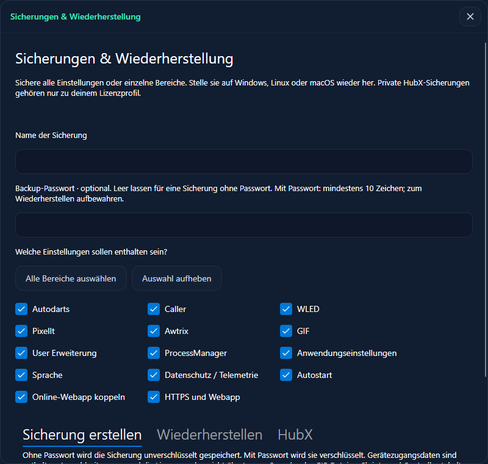
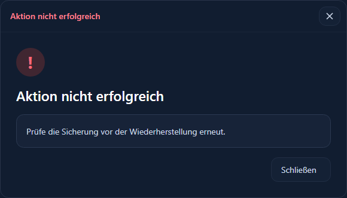
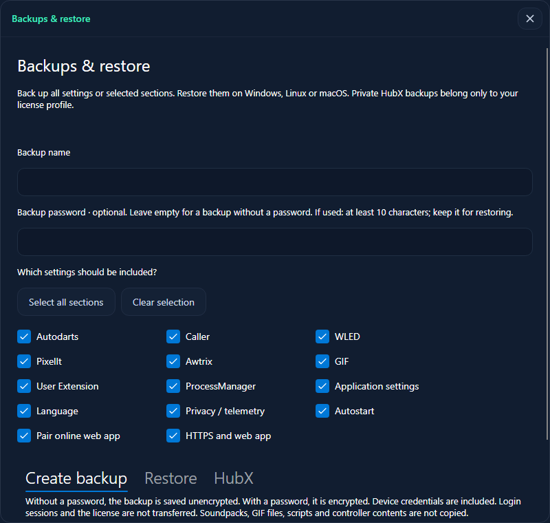
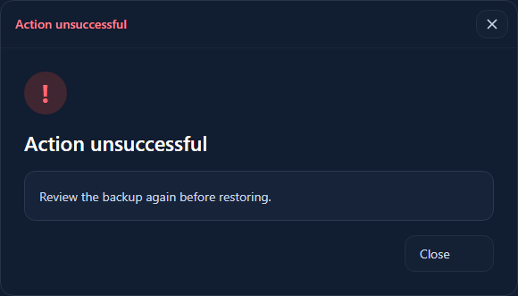

# Sicherungen / Backups

## Deutsch

Öffne **Einstellungen → Allgemein → Sicherungen & Wiederherstellung**. In der lokalen Weboberfläche und gekoppelten Webapp liegt derselbe Bereich unter Einstellungen.

1. Wähle alle Bereiche oder einzelne Module. Gib einen Namen an. Das Passwort ist optional; leer lassen für eine unverschlüsselte Sicherung. Wenn du ein Passwort verwendest, muss es mindestens zehn Zeichen haben.
2. Speichere die `.dhbackup.json` mit oder ohne Passwortschutz lokal oder privat in HubX. HubX benötigt eine gültige Lizenz mit `hubx_access` und die Zustimmung zu den aktuellen Rechtstexten.
3. Zum Wiederherstellen eine Datei oder eine eigene HubX-Sicherung auswählen. Nur bei verschlüsselten Sicherungen das Passwort eingeben, Bereiche auswählen und **Sicherung prüfen** drücken.
4. Hinweise lesen und das vollständige Ersetzen der ausgewählten Bereiche bestätigen. Andere Bereiche bleiben erhalten. Module werden direkt geladen; allgemeine, Web-, Telemetrie- und Skriptoptionen können einen Neustart benötigen.

**Inhalt:** Modulkonfigurationen einschließlich Geräte, Ereignisregeln, eingebetteter Anzeigeanpassungen und Gerätepasswörter; allgemeine Einstellungen, Sprache, Telemetrieoptionen, gespeicherte Autostart-Präferenzen sowie HTTPS-/Webapp-Einstellungen.

**Nicht enthalten:** Autodarts-Anmeldesitzung, Lizenz, Kopplungstokens, lokale Zertifikate, Soundpacks, GIF-Dateien, Skriptdateien, externe Anzeigevorlagen und Controller-Inhalte. Diese Dateien müssen separat übertragen werden. Anwendungen werden nicht automatisch gestartet; ein User-Skript muss auf dem Ziel erneut ausgewählt werden. Betriebssystem-Autostart wird auf dem Ziel separat eingerichtet. Pfade innerhalb des ursprünglichen Datenordners werden an den Datenordner der Zielinstallation angepasst; externe Pfade müssen geprüft werden.

Mit Passwort: Bewahre es sicher auf. Es wird nicht an HubX geschickt und kann nicht wiederhergestellt werden; HubX sieht dann keine entschlüsselten Einstellungen. Ohne Passwort: Die Datei enthält lesbare Einstellungen und Gerätezugänge, auch bei privater Speicherung in HubX. Fünf private Sicherungsplätze sind enthalten; Administratoren ändern das Limit in **Administration → Benutzer → Bearbeiten → Private Sicherungsplätze**. Ein volles Konto überschreibt keine alten Sicherungen automatisch. Im Profil kannst du Sicherungen herunterladen, hochladen und nach Rückfrage löschen. In jeder Installation mit derselben Lizenz kannst du sie in Darts-Hub auswählen und wiederherstellen.

### One-Click

Robbel3D setzt **nur die in der Vorlage enthaltenen Module vollständig zurück**. Alte Geräte, Ereignisregeln und Optionen dieser Module werden entfernt. Beim Zurücksetzen von WLED werden auch frühere WLED-Aktionen beim Starten/Beenden entfernt. Das 2027-Profil enthält nur WLED; das ursprüngliche Profil enthält auch Caller.

Wenn die Sicherung ausgewählt ist, enthält die ZIP-Datei `cfg.json`, `presets.json` und `module-settings.json`. Die ersten beiden gehören zur Wiederherstellung des Controllers in WLED. Die ZIP-Datei oder entpackte `module-settings.json` lässt sich im Darts-Hub-Backupdialog importieren; im Browser die entpackte JSON-Datei verwenden. **Die One-Click-ZIP ist nicht passwortverschlüsselt und enthält Zugangsdaten. Vertraulich aufbewahren.** Die enthaltene module-settings.json kann auch privat in HubX abgelegt werden; optional mit der allgemeinen Backupfunktion eine verschlüsselte Datei erstellen. Controller-Änderungen werden bei einem Fehler nicht automatisch rückgängig gemacht.

### Terminal

`DartsHub --tui` → **Einstellungen → Sicherungen & Wiederherstellung**. Dort erstellen, lokal speichern, privat in HubX ablegen oder eine lokale/Cloud-Sicherung mit Modulwahl, Prüfung und Bestätigung wiederherstellen. Dateipfade beziehen sich auf den Rechner, auf dem die TUI läuft. Das Passwort wird verdeckt eingegeben. Bestehende Dateien werden nur nach Bestätigung überschrieben.

## English

Open **Settings → General → Backups & restore**. Local web control and the paired webapp offer the same section in Settings.

1. Select all sections or individual modules. Enter a name. A password is optional: leave it empty for an unencrypted backup, or use at least ten characters to encrypt it.
2. Save the `.dhbackup.json`, with or without password protection, locally or privately in HubX. HubX requires a valid license with `hubx_access` and acceptance of the current legal terms.
3. To restore, choose a file or a HubX backup, enter its password only if encrypted, select sections and review the backup.
4. Confirm full replacement of the selected sections. Other sections remain unchanged. Modules load immediately; general, web, telemetry and script preferences may require a restart.

Included: module settings, devices, event rules, embedded display overrides, device passwords, general preferences, language, telemetry choices, saved autostart preferences and HTTPS/webapp preferences. Not included: Autodarts login, license, pairing tokens, certificates, soundpacks, GIF files, script files, external display templates or controller contents. Transfer these separately. Imported applications do not autostart; select the user script again on the destination. Configure OS autostart separately. Managed data paths are relocated to the destination data directory; review external paths.

When using a password, keep it safe: it never travels to HubX and cannot be recovered. Without a password, the settings and device credentials are readable, including in private HubX storage. Five private slots are included. Administrators adjust the quota in **Administration → Users → Edit → Private backup slots**. A full quota never silently replaces old backups. Manage files in your HubX profile, or restore directly in Darts-Hub installations using the same license.

Robbel3D One-Click fully resets only modules included in its profile, removing previous devices, rules and options. WLED startup/shutdown actions are cleared too. The 2027 profile contains only WLED; the original also contains Caller. Optional ZIP backups include `cfg.json`, `presets.json` and `module-settings.json`. Restore controller files through WLED and module settings through the Darts-Hub backup dialog (ZIP or extracted JSON; use extracted JSON in web control). **This ZIP is unencrypted and contains credentials: keep it private.** The included module-settings.json can also be saved privately to HubX; optionally create an encrypted file with the general backup function. Controller changes are not automatically rolled back after a failure.

Terminal equivalent: `DartsHub --tui` → **Settings → Backups & restore**. Create, save locally, upload privately to HubX or restore with section selection, review and confirmation. File paths refer to the TUI computer. Password entry is masked and existing files require overwrite confirmation.

## HubX-Fehler prüfen / Diagnosing HubX errors

Darts-Hub unterscheidet jetzt Verbindungsprobleme, abgelehnte Anmeldung, fehlendes Lizenzfeature, veraltete Serverdateien, ungültige Sicherungen und Serverfehler. Die Konsole zeigt für fehlgeschlagene Backup-Anfragen den Schritt (Anmeldung, Upload, Liste, Download oder Löschen), HTTP-Status und einen bekannten Fehlercode. Zugangsdaten und Sicherungsinhalte werden nicht protokolliert. Eine erfolgreiche Migration allein bestätigt nicht, dass auch alle HubX-Anwendungsdateien aktuell sind. Bei HTTP 5xx das Serverprotokoll zum gleichen Zeitpunkt prüfen.

Darts-Hub distinguishes connection failures, rejected authentication, missing license features, outdated server files, rejected backup files and server failures. Failed requests log the step (authentication, upload, list, download or delete), HTTP status and a known error code. Credentials and backup contents are not logged. A successful migration alone does not confirm that all HubX application files are current. For HTTP 5xx, check the server log at the same timestamp.

Bei `stage=upload; HTTP 422; code=json_invalid` hat HubX die äußere Anfrage abgelehnt, bevor die Sicherung geprüft wurde. Aktuelles Darts-Hub verwenden: Backup-Anfragen werden vollständig serialisiert und mit fester Länge übertragen, damit Proxy-/PHP-FastCGI-Server sie zuverlässig einlesen können.

For `stage=upload; HTTP 422; code=json_invalid`, HubX rejected the outer request before validating the backup. Use the current Darts-Hub build: backup requests are fully serialized and sent with a fixed length so proxy/PHP-FastCGI servers can read them reliably.

Erfolgsmeldungen und Fehler beim Sichern, Hochladen, Laden, Prüfen, Wiederherstellen und Löschen erscheinen als eigene Meldungsdialoge über dem Formular. Die Scrollposition bleibt erhalten; zum Lesen ist kein Hochscrollen nötig. Dies gilt auch für Websteuerung und Terminal.

Backup success and error messages appear in separate dialogs above the form for save, upload, load, review, restore and deletion. Your scroll position is preserved; no scrolling to the top is required. Web control and terminal provide the same feedback.
