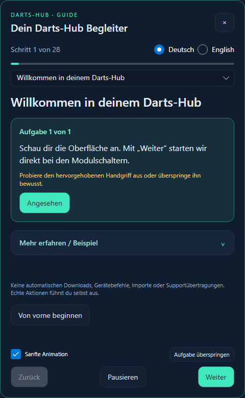
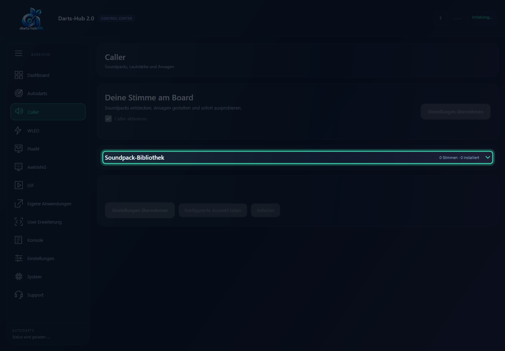
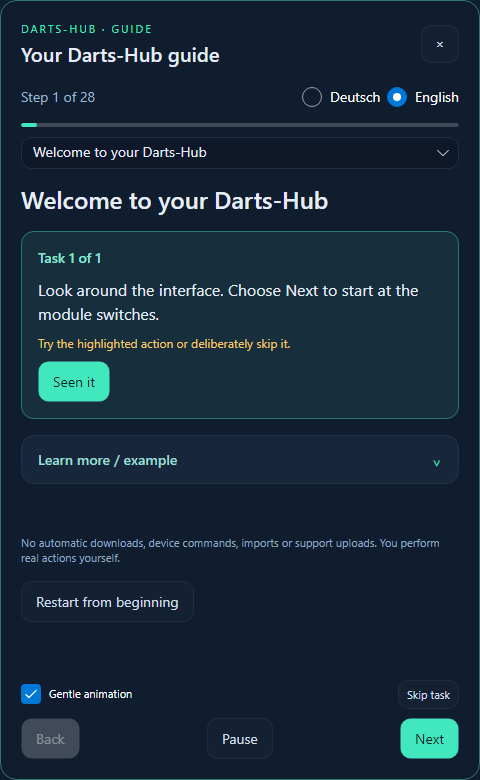
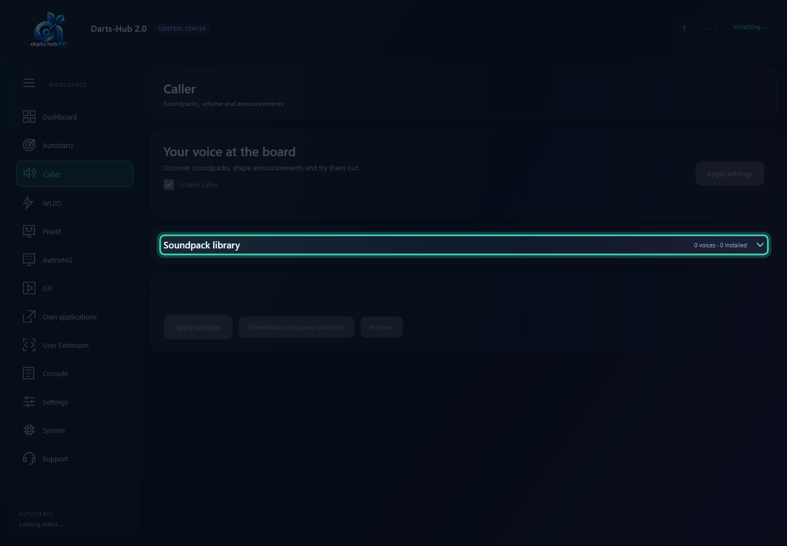

# Geführte Einführung / Guided introduction

## Deutsch

Beim ersten GUI-Start bietet Darts-Hub die Einführung an, sobald der Start und notwendige Dialoge abgeschlossen sind. Du erreichst sie jederzeit über **?** im Kopfbereich oder **Geführte Einführung** im Dashboard. Der Begleiter bleibt verschiebbar und an den Rändern skalierbar; die eigentliche Anwendung bleibt bedienbar.

- Die echten Bedienelemente werden mit einem hellen Ausschnitt hervorgehoben; der übrige Bereich wird abgedunkelt. Die Oberfläche bleibt bedienbar. Der Ausschnitt folgt Scrollen und Fenstergröße. „Sanfte Animation“ schaltet die gleitende, dezent pulsierende Hervorhebung ab oder an.
- Jedes Kapitel hat kleine Aufgaben statt eines langen Pflichttexts: etwa Bibliothek aufklappen, Sprachfilter ansehen und Suche ändern. Passende Klicks, Fokus oder Änderungen werden erkannt; eine Rückmeldung bestätigt den Handgriff. Längere Erklärungen und Beispiele stehen in einer aufklappbaren Karte im Anwendungsstil unter **Mehr erfahren / Beispiel**.
- Fehlende Elemente werden als nicht sichtbar gemeldet. **Aufgabe überspringen** führt weiter, ohne etwas einzurichten. Die Übungsregel ist weiterhin eine Simulation.
- 28 Kapitel erklären Autodarts, Lizenz, Caller, Medienpfad, Download und Aktivierung von Soundpacks, Geräte, Ereignisse, Spielerfilter, WLED, PixelIt, AWTRIX NG, GIF, Speichern, HubX, Anwendungen, Skripte, Import, Webapp, Konsole, Support und Systeminformationen.
- Der passende Bereich wird automatisch geöffnet; ein zusätzlicher „Hier zeigen“-Knopf ist nicht nötig. Nach einer erledigten Aufgabe wechselt die GUI nach kurzer Rückmeldung automatisch zur nächsten. Bei Texteingaben wird eine kurze Tipp-Pause abgewartet. Manuelle Navigation, Pause oder Schließen machen vorgemerkte Wechsel ungültig. Ungespeicherte Änderungen halten den Wechsel weiterhin auf. Die Navigation wird hervorgehoben; passende Gerätetabs beziehungsweise Ereignistabs und die Soundpack-Bibliothek werden geöffnet.
- Deutsch und Englisch lassen sich im Begleiter direkt wechseln. Standard ist die Sprache der GUI; der Umschalter im Begleiter ändert keine gespeicherte Spracheinstellung.
- Beispiele sind gekennzeichnete Lerninhalte. In der Übungsregel vergleichst du einen Auslöser mit einem simulierten Ereignis. Verständnisfragen geben sofort Rückmeldung.
- **Pausieren**, **Esc** oder **×** schließen den Begleiter. Kapitel, genaue Teilaufgabe und Animationswahl bleiben erhalten. Mit der Kapitelauswahl springst du zu einem Thema, mit **Von vorne beginnen** startest du neu und mit **Abschließen** beendest du die Einführung.
- Ungespeicherte Änderungen werden nicht umgangen. Entscheide im normalen Anwendungsdialog selbst über Speichern, Verwerfen oder Bleiben und versuche den Kapitelwechsel danach erneut.

Die Einführung führt keine Downloads, Geräte-Tests, Importe, Konfigurationsänderungen oder Supportübertragungen aus. Solche Aktionen startest du bewusst in der echten Oberfläche. Eine Geräte-Testsequenz verändert das reale Gerät; eine Soundvorschau kann hörbar sein. Lizenzbeschränkungen gelten weiterhin.

**Terminal:** Starte wie gewohnt mit `--tui`. Der Menüpunkt und die Schaltfläche **Geführte Einführung** öffnen dieselben Kapitel, Verständnisfragen und Übungsregeln. Wähle **Lerninhalt öffnen**, um das vollständige Kapitel zu lesen, und **Bereich zeigen**, um in die echte Konfiguration zu wechseln. Über die Einführung kehrst du zum Lernschritt zurück. Die vorhandene Sprachwahl unter Einstellungen gilt auch hier. Teilaufgaben werden einzeln angezeigt und nach eigenem Ausprobieren bestätigt oder übersprungen. Die Animationswahl ist auch im Terminal einstellbar und betrifft die GUI-Darstellung.

Der Fortschritt ist lokale Bedienoberflächeninformation in `learning-progress.json` im Datenordner des Frontend-Rechners. Er enthält nur Kapitel, Teilaufgabe, Animationswahl, Versionsnummer und Angebots-/Abschlussstatus. Bei einer Netzwerk-GUI liegt er auf dem GUI-Rechner, nicht auf dem entfernten Backend. Er wird nicht an Telemetrie oder Support gesendet, sofern du die Datei nicht selbst weitergibst. Wenn Speichern fehlschlägt, zeigt der Begleiter einen Hinweis. Neue Kapitel können bei Bedarf einen neuen Einführungsstand beginnen; beschädigter Fortschritt startet sicher von vorne.

## English

On first GUI launch, Darts-Hub offers the introduction after startup and required dialogs finish. Reopen it using **?** in the header or **Guided introduction** on Dashboard. Move or resize the companion while continuing to use the actual application.

Real controls are spotlighted while the surrounding interface is dimmed and remains usable. The cutout follows scrolling and resizing. Gentle animation can be disabled. Small tasks recognize clicks, focus or changes and give immediate feedback. Longer explanations and examples sit in a collapsible card styled like the application under **Learn more / example**. Missing controls are reported explicitly; **Skip task** continues without configuring anything. Progress includes the exact subtask and animation preference.

The 28 chapters cover connection, licensing, Caller and soundpacks, devices, event rules and filters, WLED, PixelIt, AWTRIX NG, GIF, saving, HubX, external applications, user scripts, import, webapp, Console, support and System. The matching area opens automatically and navigation is highlighted; there is no extra Show me button. Completed GUI tasks advance automatically after brief feedback, with a typing-pause debounce for text input. Manual navigation, pause and closing invalidate pending advances; unsaved changes still block navigation. Examples and practice rules are explicitly simulated; comprehension questions provide immediate feedback.

Switch German/English within the guide without changing the saved application language. Pause with **Pause**, **Esc** or **×** and resume later. Choose any chapter, restart, or finish. Normal unsaved-change prompts remain active; resolve them yourself and retry navigation. The guide does not download, save/discard settings, send hardware commands, import or upload support data. You perform real actions yourself, subject to normal licensing and confirmation rules. Real previews can affect hardware or produce sound.

**Terminal:** launch with `--tui`, then select **Guided introduction** from navigation or its button. **Open lesson** displays the full content; **Show section** opens actual settings. Return using the introduction action. The same lessons, checks and rule practice are available, using the existing language setting. Each subtask is shown separately and acknowledged after trying it, or skipped. The animation preference is also available in the terminal and affects GUI presentation.

Progress is stored locally on the frontend computer in `learning-progress.json` under its data directory: chapter, subtask, animation preference, guide version and offered/completed flags only. A network GUI stores this on the GUI computer. This file is not sent through telemetry or support unless you share it yourself. Persistence failures display a notice; invalid progress safely restarts the guide.
