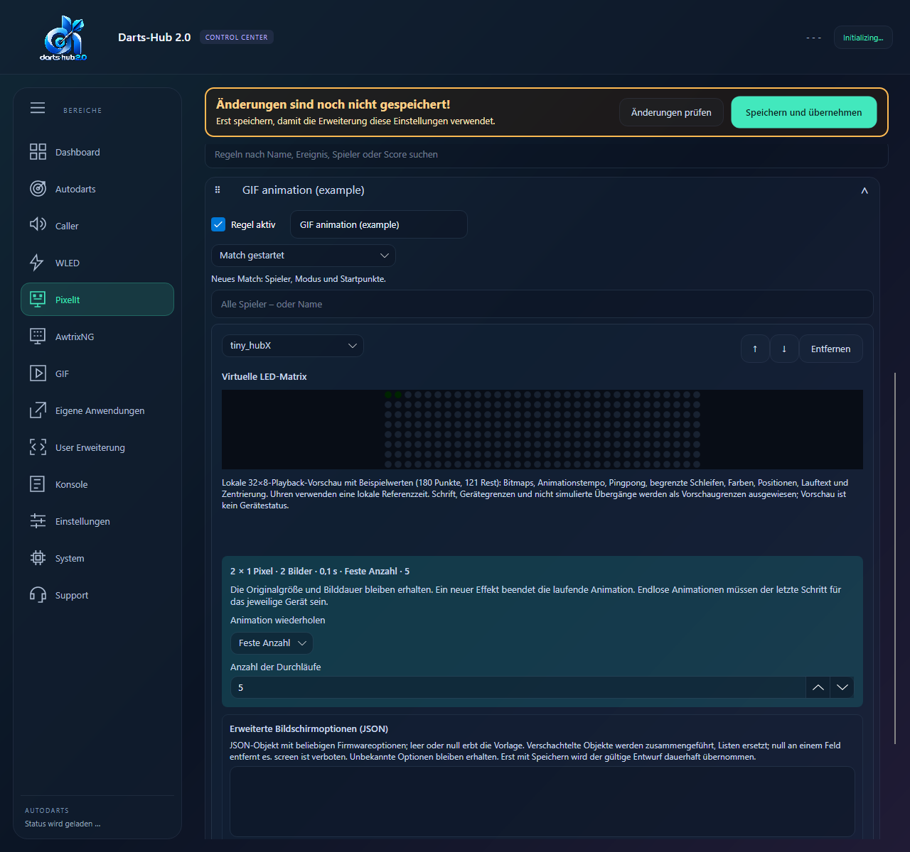
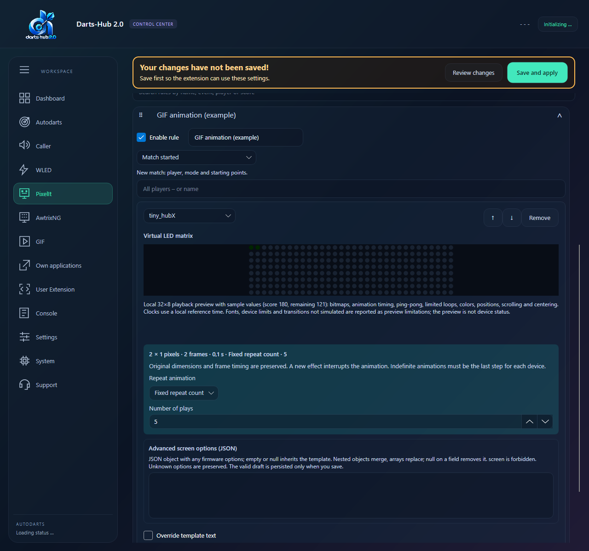

# HubX GIF import

## Deutsch
### Als PixelIt-Animation übernehmen
1. In HubX beim GIF **An Darts-Hub senden** wählen oder die Paket-JSON herunterladen und in Darts-Hub importieren.
2. Im Posteingang **Als animierte PixelIt-Vorlage übernehmen** auswählen. Es wird kein AWTRIX-Gerät benötigt.
3. Einen Vorlagennamen vergeben und **Feste Anzahl (1–100 Durchläufe)**, **Bis zum nächsten Effekt** oder **Bis zum nächsten Turn** wählen.
4. Übernehmen. Die Vorlage steht sofort im PixelIt-Modul zur Verfügung. In einer Ereignisregel auswählen und die Zielgeräte einstellen. Unter „Animation wiederholen“ kannst du die Vorgabe der Vorlage verwenden oder sie für dieses Ereignis überschreiben.

Nur GIFs mit **Breite bis 32 und Höhe bis 8 Pixeln** sind erlaubt. Sie behalten ihre Originalgröße und Bilddauer; kleine GIFs werden nicht hochskaliert, größere werden abgelehnt. Transparente Bildbereiche erscheinen schwarz. Maximal 1024 Bilder und 1 MiB erzeugte Vorlagendaten sind erlaubt. GIFs ohne angegebene Bilddauer verwenden 100 ms.

Darts-Hub spielt die Bilder nacheinander auf dem Controller ab und muss dafür laufen. Netzwerk und Controller begrenzen die erreichbare Geschwindigkeit. Ein neuer Effekt auf demselben Gerät unterbricht die Animation in jedem Modus. „Bis zum nächsten Turn“ endet auch bei einem neuen Turn desselben Spielers und bei einem Legwechsel. Wenn ein Idle-Ereignis eingestellt ist, wird es beim Turnwechsel verwendet. Matchende, Trennen der Autodarts-Verbindung, Ausschalten des Moduls und Beenden von Darts-Hub stoppen die Wiedergabe. Nach einer festen Anzahl bleibt das letzte Bild bis zum nächsten Effekt stehen. Endlose Animationen müssen der letzte Schritt für das betreffende Gerät sein. Die Testsequenz spielt endlose Animationen einmal ab, damit der Test beendet werden kann.

Gleiche Vorlagen werden wiederverwendet; bei anderem Inhalt wird ein freier Name mit Zähler und `_hubX` vergeben. Die ursprüngliche Datei wird nicht überschrieben. Geteilte PixelIt-Ereignisse und Einzelvorlagen enthalten auch Animations- und Wiederholungseinstellungen.

Terminal: **HubX-Posteingang → Übernehmen → Als animierte PixelIt-Vorlage übernehmen → Name/Wiederholung → Übernehmen**. Im PixelIt-Schrittmenü stehen „Animation wiederholen“ und „Anzahl der Durchläufe“ bereit. GUI, lokale Weboberfläche und gekoppelte Webapp verwenden denselben Import.

### Auf AWTRIX-NG hochladen
Einzelne GIF-Beiträge werden im HubX-Posteingang bestätigt. Wähle den AWTRIX-NG-Controller, auf den das GIF geladen werden soll. Bei gleichen Dateinamen zeigt Darts-Hub beide Bilder; du kannst überschreiben, umbenennen oder abbrechen. Die vorhandenen Gerätezugänge werden verwendet. Große GIFs werden nur mit deiner ausdrücklichen Zustimmung verkleinert. Das GIF ist danach als Icon für AWTRIX-Ereignisse auswählbar; eine Ereignisregel wird beim Upload nicht angelegt. GIF-Ereignispakete bleiben dem lokalen GIF-Modul zugeordnet.

GUI: Dashboard → HubX → Posteingang. Terminal: HubX-Posteingang öffnen, Übernehmen, Zielgerät wählen, optional Größenanpassung erlauben und Namenskonflikte auflösen. Lokale Weboberfläche und gekoppelte Webapp bieten denselben Ablauf. Auch heruntergeladene HubX-Paketdateien benutzen diese Prüfung.

## English
### Import as a PixelIt animation
1. Select **Send to Darts-Hub** on a HubX GIF, or download its package JSON and import the file in Darts-Hub.
2. Select **Import as an animated PixelIt template** in the inbox. No AWTRIX device is required.
3. Choose a template name and **Fixed repeat count (1–100 plays)**, **Until the next effect**, or **Until the next turn**.
4. Accept. The template becomes available immediately in PixelIt. Select it in an event rule and set the target devices. “Repeat animation” can inherit the template settings or override them for that event.

Only GIFs with **width up to 32 and height up to 8 pixels** are accepted. Original dimensions and frame timing are preserved: smaller GIFs are not enlarged and larger ones are rejected. Transparency appears black. Limits are 1024 frames and 1 MiB of generated template data. Frames with unspecified timing use 100 ms.

Darts-Hub streams frames to the controller and must remain running. Network and controller speed limit achievable frame rates. A new effect on the same device interrupts playback in every mode. “Until the next turn” also ends on a new turn by the same player or a leg change; a configured Idle event is applied at the turn boundary. Match completion, Autodarts disconnect, disabling the module and closing Darts-Hub stop playback. Finite playback holds its last frame until another effect. Indefinite animations must be the last step for that device. Test sequences play indefinite animations once so the test can complete.

Identical templates are reused; different content gets an available name with a counter and `_hubX`. Existing files are preserved. Shared PixelIt events and standalone templates retain animation and repetition settings.

Terminal: **HubX inbox → Accept → Import as an animated PixelIt template → Name/repetition → Accept**. The PixelIt step menu exposes “Repeat animation” and “Number of plays”. GUI, local web UI and paired webapp use the same import.

### Upload to AWTRIX-NG
Confirm standalone GIF contributions in the HubX inbox and choose the AWTRIX NG controller to receive them. Matching filenames show a comparison with overwrite, rename and cancel actions. Stored device credentials are used. Oversized GIFs are resized only with explicit consent. The uploaded GIF is available as an AWTRIX event icon; uploading does not create an event rule. GIF event packages still belong to the local GIF module.

GUI: Dashboard → HubX → Inbox. Terminal: open the HubX inbox, accept, select the target device, optionally allow resizing and resolve filename conflicts. Local web UI, paired webapp and downloaded HubX package files use the same review and validation.

Weitere Beiträge und Einzelressourcen / Other packages and standalone resources: [HubX](HUBX.md).
