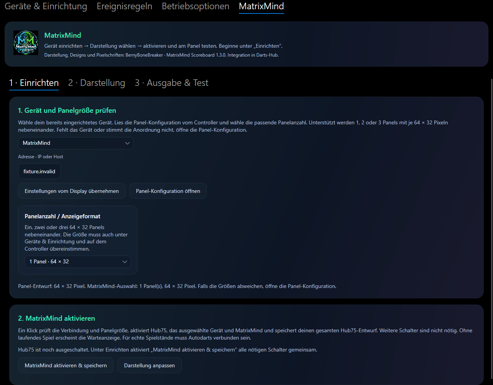
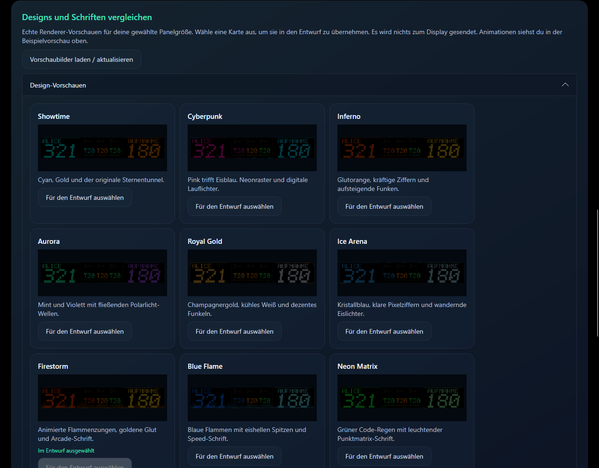
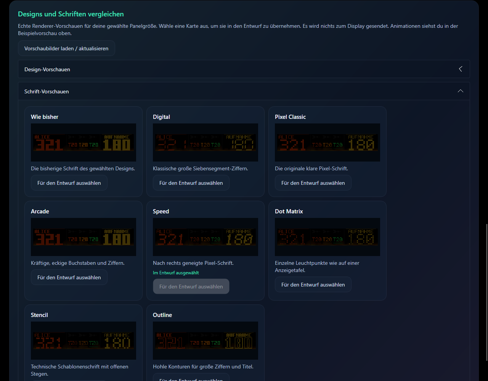
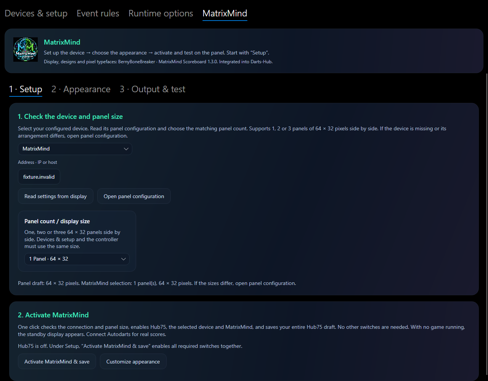
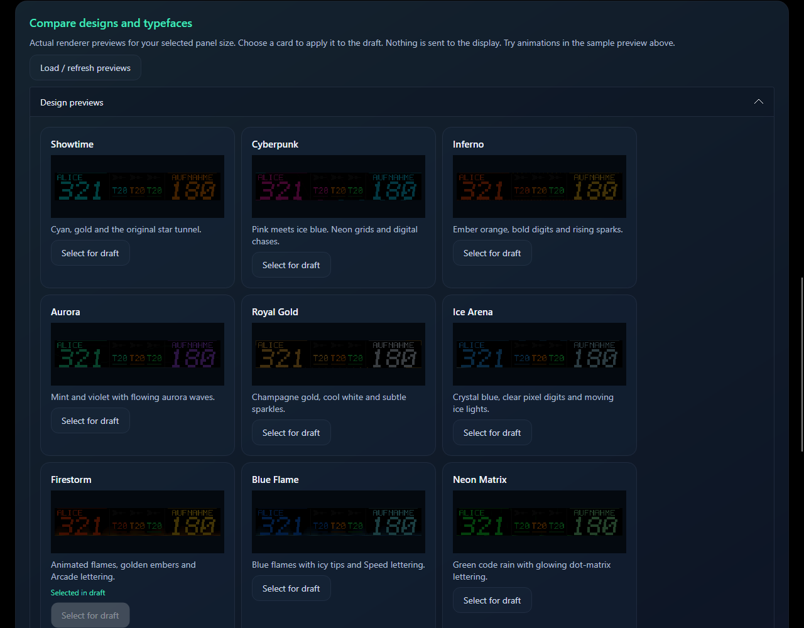
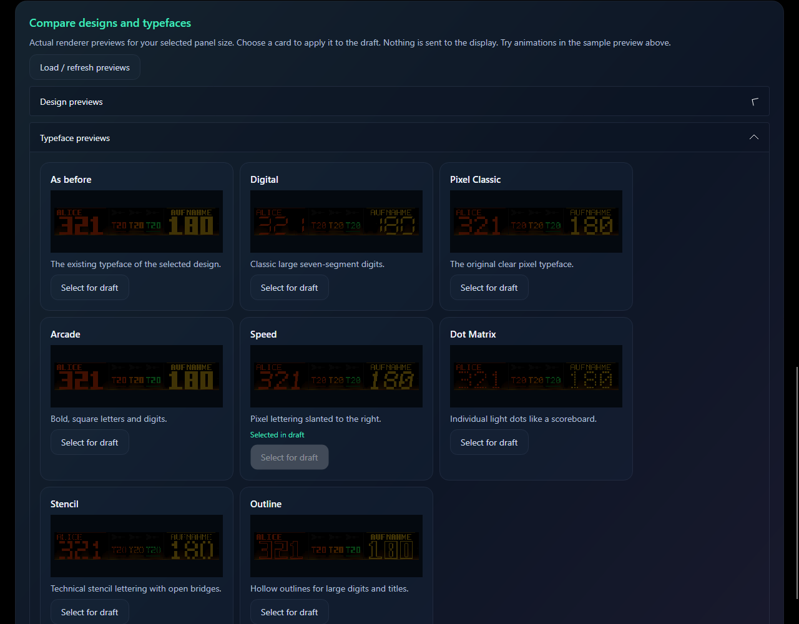
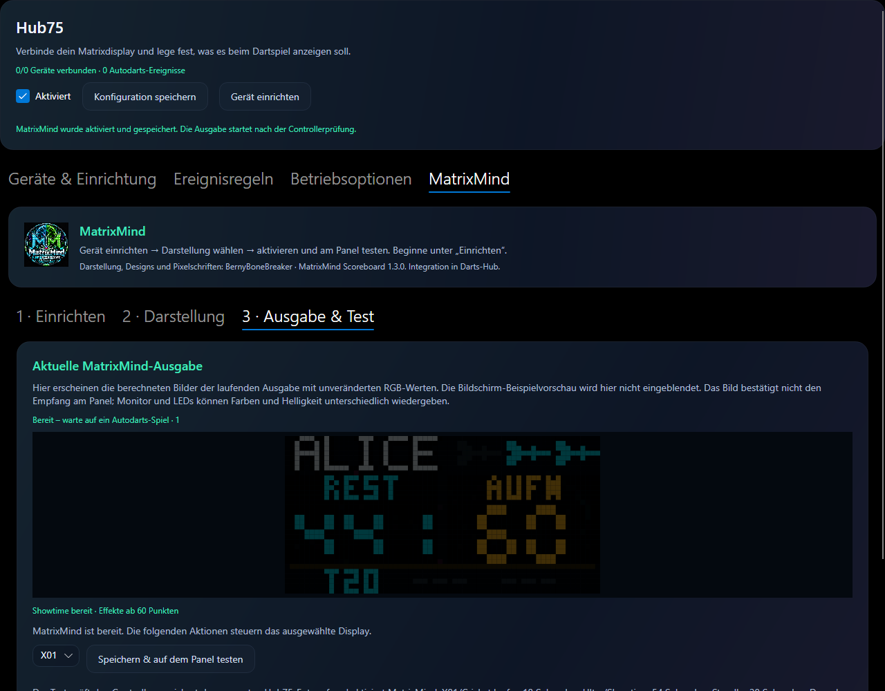
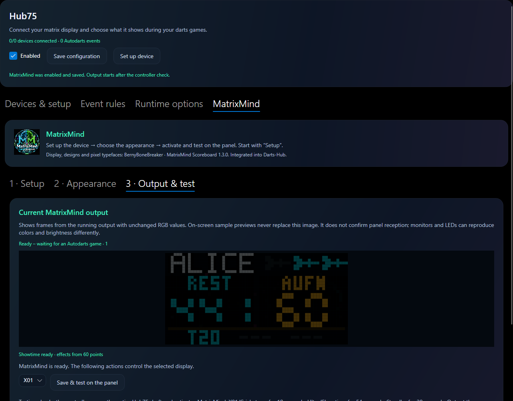

# MatrixMind · Hub75 Scoreboard

## Deutsch

MatrixMind übernimmt die Anzeige aus **MatrixMind Scoreboard 1.3.0 von
BernyBoneBreaker** direkt in Darts-Hub. Der native C#-Renderer erhält Spieldaten
aus der vorhandenen Autodarts-Websocket-Verbindung. Eine separate EXE, ein
Browsergrabber oder eine Python-Installation sind für MatrixMind nicht nötig.

### Panels und Anzeige wählen

| Panels nebeneinander | Auflösung | Darstellung |
| --- | --- | --- |
| 1 | 64 × 32 | Originales Kompaktlayout, Showtime und Digital fest |
| 2 | 128 × 32 | Eigenes kompaktes HUD, 18 Designs und 8 Schriftoptionen |
| 3 | 192 × 32 | Originales breites HUD, 18 Designs und 8 Schriftoptionen |

1. Unter **Hub75 → Geräte & Einrichtung** den Controller auswählen oder hinzufügen.
   Der optionale Assistent hilft bei Verdrahtung, Firmware und WLAN. Nur dessen
   USB-Flashwerkzeuge benötigen weiterhin Python; MatrixMind selbst nicht.
2. 64 × 32 als Panelgröße, **1, 2 oder 3 Spalten** und **1 Reihe** einstellen.
   Die tatsächliche Verkabelung und Ausrichtung konfigurieren und auf den Controller
   übertragen. WLED muss DDP im lokalen Netzwerk auf UDP-Port 4048 empfangen können.
3. Unter **Hub75 → MatrixMind → Einrichten** Gerät und passende Panelanzahl wählen.
   **MatrixMind aktivieren & speichern** prüft Verbindung und Größe, aktiviert Modul,
   Gerät und MatrixMind gemeinsam und speichert den gesamten Hub75-Entwurf.
   Weitere Schalter sind nicht nötig. Ohne Spiel erscheint die Standby-Anzeige.
4. Unter **Darstellung** Helligkeit (8–120) und Animationen einstellen; bei zwei
   oder drei Panels auch Design und Schrift wählen. **Vorschaubilder laden**
   zeigt echte Rendererbilder mit Beispieldaten für die gewählte Größe. Designs
   und Schriften sind getrennt aufklappbar; **Auswahl übernehmen** ändert den Entwurf.
5. **Vorschau mit Beispieldaten starten** spielt X01 oder Cricket (je 18 Sekunden),
   Ultra/Showtime (54 Sekunden) oder das Wartelogo Standby (20 Sekunden) ab.
   Die Vorschau braucht kein eingeschaltetes Display und sendet keine Paneldaten.
6. Unter **Ausgabe & Test** übernimmt **Speichern & auf dem Panel testen** den
   gesamten Entwurf nach einer Controllerprüfung und startet die gewählte Demo.
   Die Ausgabe zeigt ausschließlich aktuelle Rendererbilder, keine Bildschirmdemo.
   Autodarts verbinden und ein Spiel starten. **MatrixMind deaktivieren** schaltet
   nur MatrixMind aus; Hub75 und das Gerät bleiben eingeschaltet.

**Designs:** Showtime, Cyberpunk, Inferno, Aurora, Royal, Ice, Firestorm, Blue Fire,
Matrix, Synthwave, Laser, Retro, Mario, Sonic, Pac-Man, Tetris, Invaders und Zelda.
**Schriften:** passend zum Design, Digital, Pixel, Arcade, Speed, Dots, Stencil und
Outline. Das sind die originalen Pixelschriften; ein Import von TTF-Dateien ist
nicht vorgesehen. Die Schriftwahl betrifft die Zifferndarstellung des Originals,
nicht jedes kleine HUD-Label.

Bei einem Panel sind Design und Schrift wie im Original fest. Eine zuvor gewählte
breite Darstellung bleibt gespeichert und wird beim Wechsel auf zwei oder drei
Panels wieder verwendet. Bereits gespeicherte ältere MatrixMind-Konfigurationen
bleiben bei drei Panels; für neue Einstellungen wird eine passende vorhandene
Panelkonfiguration als Vorgabe übernommen. Die Panelanzahl in MatrixMind ändert
nicht automatisch die Hardwarekonfiguration.

### Vorschau, Ausgabe und Ereignisse

Änderungen bleiben bis zum Speichern Entwürfe. Eine laufende Beispielvorschau
startet mit geänderten Werten neu. Gerätewechsel, Verlassen des Reiters und
Schließen beenden sie. Bildschirmvorschau und Ausgabe verwenden unveränderte
RGB-Werte ohne künstliche Aufhellung. Monitor und LEDs können Farben und
Helligkeit dennoch unterschiedlich wiedergeben.

Die Geräte-Vorschau zeigt die aktuell berechneten Bilder, auch während einer
Übertragungspause. Sie ist keine Empfangsbestätigung des Controllers. Die Ausgabe
zielt wie das Original auf bis zu 40 Bilder pro Sekunde; die Geräte-Vorschau wird
bis zu zehnmal pro Sekunde aktualisiert. Netzwerk und Rechner können das begrenzen.
**Übertragung pausieren** sendet zunächst Schwarz und stoppt weitere DDP-Pakete.
Fortsetzen, Speichern oder Neustart setzt die Ausgabe fort. Demos im Abschnitt
**Ausgabe & Test** werden tatsächlich auf das Panel gesendet;
**Zurück zum Spiel** beendet sie. Neue Spieldaten beenden eine Demo ebenfalls.

X01, Random Checkout, Cricket, Tactics und Hidden Cricket nutzen die ursprüngliche
Zustands- und Animationslogik einschließlich Korrekturen, Undo, Spielerwechsel,
Checkout, 180 und Bust. Manuell eingetragene Darts lösen für alle Spieler
dieselben Animationen aus wie erkannte Würfe. Ereignisregeln für MatrixMind-Geräte bleiben gespeichert,
pausieren aber während MatrixMind aktiviert ist. Geräte-GIFs werden weiterhin
unter **Geräte & Einrichtung → GIFs verwalten** hochgeladen, heruntergeladen,
angesehen oder gelöscht, sofern die Controllerfirmware den Image-Effekt anbietet.
Sie ersetzen nicht die eingebauten MatrixMind-Animationen. Eine zusätzliche
WLED-Streifensteuerung und Discord wurden nicht übernommen.

Die Diagnose zeigt Zustand, sichere Fehlercodes, Framezähler und die letzten
30 Zustands-/Effektwechsel, ohne Spielernamen, Spielstände, Zugangsdaten oder Bilder.

### Terminal

`DartsHub --tui` → **Hub75 → Gerät · MatrixMind**:

- **Konfigurieren:** Aktivierung, Helligkeit, Animationen und Panelanzahl als Entwurf.
- **Design & Schrift:** die gleichen Auswahlmöglichkeiten für zwei oder drei Panels.
- **Vorschaubilder:** Design oder Schrift auswählen, echte Pixel als abgestufte
  Textvorschau ansehen und anschließend in den Entwurf übernehmen.
- **Vorschau mit Beispieldaten starten:** die gleichen vier Szenarien und Größen.
- **Einrichten** erklärt dieselben Schritte. **MatrixMind aktivieren & speichern**
  aktiviert alle drei Schalter gemeinsam. **Speichern & auf dem Panel testen**
  übernimmt den gesamten Entwurf vor dem Paneltest.
- Deaktivieren, Controllerprüfung, Pause/Fortsetzen, Zurück zum Spiel und
  Diagnose anzeigen/exportieren entsprechen der GUI.

Die native mobile App bietet noch keine eigenen MatrixMind-Bedienelemente und
bewahrt diese Einstellungen bei anderen Änderungen. Die Beispielvorschau wird
nicht über das Webrelay weitergeleitet.

## English

MatrixMind integrates **MatrixMind Scoreboard 1.3.0 by BernyBoneBreaker** as a native
C# renderer. Game data comes from Darts-Hub’s Autodarts WebSocket connection.
No separate executable, browser capture or Python installation is needed for
MatrixMind. Only the optional USB flashing tools in the Hub75 setup guide still
require Python.

Choose **one, two or three 64 × 32 panels side by side**: 64×32, 128×32 or 192×32.
Configure the actual panel arrangement and wiring under **Hub75 → Devices & setup**
and apply it to WLED first. WLED must accept DDP on local UDP port 4048. Under
**Hub75 → MatrixMind → Setup**, select the device and matching panel count.
**Activate MatrixMind & save** checks connection and dimensions, enables module,
device and MatrixMind together, and saves the entire Hub75 draft. No other switches
are needed. Without a game, standby appears. Under **Appearance**, adjust brightness
(8–120), animations and supported design/font choices.

Two and three panels support all **18 original designs and 8 pixel-font options**
listed above. These are built-in number fonts, not imported TTF fonts or replacements
for every small HUD label. One panel uses the original fixed Showtime/Digital
compact layout; previous wider design/font selections are retained when switching
sizes. Existing saved configurations default to three panels. New settings infer
supported dimensions from the configured panels. Selecting a MatrixMind size does
not automatically reconfigure the controller.

**Load previews** renders real sample images at the selected size, grouped into
expandable design/font galleries. Select a card to update the draft. **Start sample
preview** plays X01/Cricket (18 seconds each), Ultra/Showtime (54 seconds) or the
Standby logo (20 seconds), without sending data to a controller. Changing settings
restarts the sample; navigation/device changes stop it. **Check controller & save**
checks reachability and actual dimensions before saving. Under **Output & test**,
**Save & test on the panel** checks and saves the complete draft, activates output
and starts the selected demo. This page shows only current output frames, never
the screen-only sample preview. Connect Autodarts and start a game. **Deactivate
MatrixMind** saves its disabled switch while leaving Hub75 and the device enabled.

The device preview shows rendered frames, not delivery acknowledgement. Screen
and outgoing images use unmodified RGB values without artificial brightness gain.
Monitors and LEDs can still reproduce colors and brightness differently.
Output targets up to 40 fps and device previews refresh up to 10 fps,
subject to host/network capacity. Pause first blanks the display, then stops DDP;
resume, saving or restarting resumes output. Panel demos send to the actual display;
return to game or new game data ends them. Event rules for enabled MatrixMind devices
remain saved but paused. Device GIFs remain available under Devices & setup when
the firmware offers the Image effect. The additional WLED strip and Discord
integrations are deliberately excluded.

X01, Random Checkout, Cricket/Tactics/Hidden Cricket use the original state and
effect logic. Manually entered darts trigger the same animations as detected
throws for every player. Diagnostics omit player names, scores, credentials and pixel data.

Terminal equivalents: `DartsHub --tui` → **Hub75 → device · MatrixMind** → Configure
(basic settings/panels), Design & font, Preview images (graded text rendering and
draft selection), Start sample preview, Activate MatrixMind & save, Save & test
on the panel, Deactivate MatrixMind, Check controller & save, pause/resume and
diagnostics/export. Setup explains the same steps. Both frontends share validation.
The mobile companion has no dedicated MatrixMind controls yet and preserves these
settings when editing other values. Sample streams are not relayed remotely.

## Verification / Prüfung

The native renderer was compared with **32,251 independently captured original
1.3.0 frames**, including RGB SHA-256, effects and complete DDP packets, all three
sizes, all designs/fonts, demo timelines, standby and real snapshot corrections.
Fixtures run without Python. Cross-built Windows/Linux/macOS x64/ARM64 packages
are not proof of native execution on every platform or physical panel reception.
Original license and file hashes: `MatrixMind/Original13/NOTICE.txt` and
`provenance.json` in the Hub75 module. See `scripts/matrixmind/README.md` for review
and reproduction instructions.

## Bildabweichungen prüfen / Checking display differences

Unter **Darstellung** Animationen ausschalten, unter **Ausgabe & Test** X01 wählen
und **Speichern & auf dem Panel testen** drücken. Das ergibt einen ruhigen Vergleich.
Showtime enthält im Original Hintergründe, Zooms und Übergänge. Zusätzliche bewegte
WLED-Effekte gehören nicht in die laufende DDP-Ausgabe. Langsame regelmäßige
Controllerabfragen unterbrechen den Bildversand nicht mehr. Bei weiteren Abweichungen
andere DDP-Sender, WLED-Echtzeitübersteuerung und Panelanordnung prüfen.
Das Controller-Livebild benötigt vollständige Pixelübertragung durch die Firmware.
Reduzierte Bilder werden mit einem Einrichtungshinweis abgewiesen. Dies gilt auch
für GIFs und WLED-Effekte. [Firmware-Erweiterung](../scripts/wled-full-preview/README.md).
Das Controllerbild bleibt von der berechneten MatrixMind-Ausgabe getrennt.

For a steady comparison, turn animations off under **Appearance**, select X01 under
**Output & test**, then **Save & test on the panel**. Original Showtime includes
backgrounds, zooms and transitions. Additional WLED effects should not appear during
active DDP output. Slow periodic controller queries no longer interrupt frame sending.
If differences persist, check other DDP senders, WLED realtime override and panel
arrangement. Controller live view requires full pixel transmission by the firmware;
reduced frames show a setup message instead. This applies to GIFs and WLED effects
too. [Firmware extension](../scripts/wled-full-preview/README.md). Controller frames
remain separate from rendered MatrixMind output.

### Vorschauleistung / Preview performance

Die GUI hält für jede sichtbare MatrixMind-Vorschau ein Pixelbild in ihrer nativen
Auflösung vor. Scrollen und Größenänderungen verwenden dieses Bild wieder;
neue Frames ersetzen es. Beim Entfernen der Ansicht werden die Bildressourcen
freigegeben. Farben, Schriftarten, Animationen und die an den Controller
übertragenen Pixel bleiben unverändert. Die Galerie enthält weiterhin alle
Designs und Schriften. Die TUI-Galerie und ihre Auswahlaktionen bleiben gleich;
die Optimierung betrifft ausschließlich die grafische Darstellung am Host.

The GUI caches each MatrixMind preview at its native pixel resolution. Scrolling
and resizing reuse that image; new frames replace it. Removing the view releases
its image resources. Colors, fonts, animations and pixels sent to the controller
are unchanged. All designs and fonts remain available. The TUI gallery and its
selection actions are unchanged; this optimization affects host GUI drawing only.
