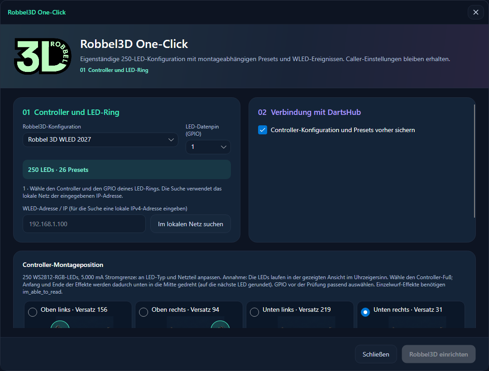
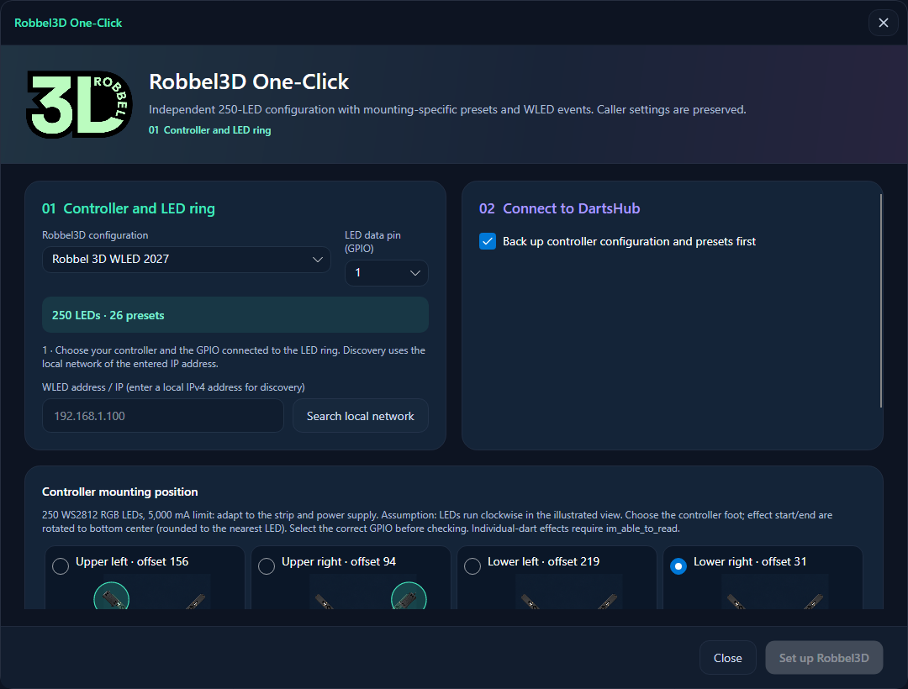

# Robbel3D One-Click

**Aktuell / Current:** One-Click ersetzt die Module der ausgewählten Vorlage vollständig; frühere Geräte, Regeln und Optionen werden entfernt. Die optionale ZIP sichert auch die vorherigen Moduleinstellungen. / One-Click fully replaces modules included in the selected profile; old devices, rules and options are removed. Optional ZIP backups also contain previous module settings. [Backup-Anleitung / Backup guide](BACKUPS.md).

## Deutsch

In der GUI unter **WLED → Robbel3D One-Click** öffnen. Die Einrichtung verwendet
die ursprüngliche Robbel3D-Konfiguration mit 145 LEDs und sechs benannten Presets.
Sie ist im Programm enthalten; zusätzliche Konfigurationsdateien sind nicht nötig.

1. Konfiguration und WLED-Adresse auswählen. Für die Gerätesuche eine lokale
   IPv4-Adresse eingeben; die Suche prüft das zugehörige /24-Netz. Hostnamen und
   HTTPS-Adressen können direkt eingegeben werden.
2. Den GPIO des angeschlossenen LED-Rings wählen. Die vorhandene Board-ID und
   der Soundpack-Ordner werden vorgeschlagen. Der Medienordner muss auf dem
   Rechner vorhanden sein, auf dem die DartsHub-Runtime läuft.
3. **Prüfen und Vorschau anzeigen** wählen. Die Liste zeigt die übernommenen
   Einstellungen und auch alte Optionen, die im neuen Hub entfallen. Alte
   Caller-Serverports und Zertifikatsschalter werden nicht übernommen.
4. Zielgerät, GPIO und Vorschau prüfen und bestätigen. **Robbel3D einrichten**
   sichert den Controller, überträgt die LED-Konfiguration und Presets, prüft
   das Ergebnis und übernimmt die Caller-/WLED-Einstellungen sofort.
5. Mit **Sicherung speichern** die ursprüngliche `cfg.json` und `presets.json`
   als ZIP herunterladen. Die enthaltenen Dateien können bei Bedarf in WLED
   unter **Config → Security & Updates → Backup & Restore** eingespielt werden.

WLAN, Gerätekennung und übrige Controller-Einstellungen bleiben erhalten.
Weitere LED-Ausgänge werden deaktiviert und vorhandene Presets ersetzt. Bereits
belegte GPIOs werden abgelehnt. Die alten Vorlagen enthalten teilweise längere
Segmentgrenzen; die Einrichtung begrenzt sie auf die 145 LEDs des LED-Rings.
Die Autodarts-Anmeldung und Lizenzregeln bleiben bestehen. Ein Werksreset vor
dem Upload ist nicht erforderlich; Netzwerk- und Zugangseinstellungen werden
bewusst erhalten.

Bei einem Fehler werden keine ungeprüften Anwendungseinstellungen übernommen.
Der Controller kann jedoch bereits geändert sein; eine erstellte Sicherung
bleibt auch dann herunterladbar. Fortschritt und Fehler werden im Dialog
angezeigt. Nach Änderungen seit der Vorschau muss erneut geprüft werden.

### Terminal

`DartsHub --tui` starten, **WLED → Robbel3D One-Click** wählen und Konfiguration,
Adresse, GPIO, Board-ID, Medienordner und Sicherung angeben. Der Dialog bietet
dieselbe Vorschau, Bestätigung, Einrichtung und Sicherung. **Im lokalen Netz
suchen** zeigt die gefundenen Controller-Adressen.

Bei einem getrennt gestarteten Headless-Dienst verbindet sich die TUI mit
`DartsHub --tui --api-url http://127.0.0.1:5069`. Vorschau und Fortschritt
werden auch während des geöffneten Dialogs aktualisiert. Bei einem Prüffehler
wird die Ursache angezeigt und der Dialog lässt sich wieder schließen.

## English

Open **WLED → Robbel3D One-Click** in the GUI. The original 145-LED Robbel3D
configuration and its six named presets are bundled into the application.

Select the device address and LED GPIO, check the board ID and media folder,
then choose **Validate and preview**. Discovery accepts a private IPv4 address
and searches its /24 network; hostnames and HTTPS addresses can be entered
directly. The media folder must exist on the computer running the runtime.
Confirm the displayed changes and select **Set up Robbel3D**. Progress reflects
device backup, configuration upload, preset upload, verification and immediate
application of Caller/WLED settings.

Wi-Fi, device identity, other controller settings, Autodarts login and licensing
are preserved. Additional LED outputs are disabled and existing presets replaced.
Occupied GPIOs are rejected. Legacy segment bounds are limited to the ring's
145 LEDs. Obsolete Caller server ports and certificate switches are displayed
as unsupported in the preview. A factory reset is unnecessary.

**Save backup** downloads a ZIP containing the original `cfg.json` and
`presets.json`. Restore the extracted files using WLED's **Config → Security &
Updates → Backup & Restore**. A failed setup may have already changed the device;
its backup remains available. Unverified application settings are not committed.

For the terminal equivalent, run `DartsHub --tui`, open **WLED → Robbel3D
One-Click**, enter the same inputs and use the shared preview/confirmation flow.
**Search local network** lists discovered device addresses.

With a separately started headless service, connect using
`DartsHub --tui --api-url http://127.0.0.1:5069`. Preview and progress updates
continue while the dialog is open. Validation errors display their cause and
allow the dialog to be closed again.

## Implementation references

The original hub's `Robbel3DConfigurationManager`, `Robbel3DConfigWindow` and
`configs/robbel3d-configuration.json` define the profile, settings and upload
flow. Only the LED hardware block is bundled from its controller configuration;
the donor controller's network and security settings are excluded.
WLED's [JSON API](https://kno.wled.ge/interfaces/json-api/) documents named
presets, saving segment bounds/brightness and deleting presets. Both legacy
file uploads and modern JSON configuration/preset uploads are supported.

## Eingaben prüfen / Check setup inputs

Der verschiebbare und skalierbare Dialog trennt Controller/GPIO, Hub-Einstellungen und Prüfung. Der tatsächlich eingestellte Caller-Medienordner wird vorgeschlagen; der verwaltete Standardordner wird bei Bedarf angelegt. Ein selbst gewählter Ordner muss bereits auf dem Darts-Hub-Rechner existieren. Fehlende Board-ID, falscher GPIO oder Medienpfad werden einzeln benannt. Diese Prüfungen gelten auch in der TUI unter WLED → Robbel3D. Nach Änderungen muss vor dem Einrichten erneut geprüft und bestätigt werden.

The movable, resizable dialog separates controller/GPIO, Hub settings and review. It proposes the active Caller media folder and creates the managed default library when needed. A custom folder must already exist on the Darts-Hub host. Invalid board IDs, GPIOs and media paths receive specific messages, also in the TUI under WLED → Robbel3D. Recheck and confirm after changing inputs.

Die Konfigurationsvorlagen sind fest in der Anwendung enthalten; es gibt derzeit keinen Vorlageneditor oder Dateiimport für neue One-Click-Profile. Neue Profile müssen im Quellcode ergänzt und mit der Anwendung gebaut werden. / One-Click profiles are bundled with the application. There is currently no profile editor or file import for adding profiles; new profiles require a source change and rebuild.

Nach dem Zurückschreiben werden LED-Typ, GPIO, Länge, Farbreihenfolge und aktive Ausgänge zurückgelesen und geprüft, bevor Presets und Hub-Einstellungen übernommen werden. Die Sicherung enthält cfg.json und presets.json, kein vollständiges Controller-Dateisystem. / After writing, setup verifies LED type, GPIO, length, color order and active outputs before applying presets and Hub settings. The backup contains cfg.json and presets.json, not the complete controller filesystem.

## Robbel 3D WLED 2027 — 250 LEDs

Eigenständiges Probierpaket für einen Ring mit 250 WS2812-RGB-LEDs: 5.000 mA Strombegrenzung, globale Helligkeit 180/255 und ein auswählbarer GPIO (Vorschlag 1). LED-Typ, Stromgrenze und GPIO müssen zur echten Hardware passen. Alle anderen Controller-Einstellungen bleiben erhalten. Die Vorlage verändert nur WLED, keine Caller-Einstellungen. Wie beim bisherigen One-Click werden vorhandene Controller-Presets ersetzt; Sicherung und Vorschau bleiben verfügbar.

**Annahme:** Die LED-Kette läuft in der gezeigten Ansicht im Uhrzeigersinn, physische LED 0 liegt am ausgewählten Controller-Fuß. Ein vollständiges Segment `[0,250)` mit WLED-Offset `of` dreht den logischen Effektanfang nach unten in die Mitte. Das logische Ende liegt direkt daneben. Der Ring wird nicht in zwei unabhängig animierte Segmente zerschnitten. Rundung auf die nächste LED (maximal 0,36° Fehler).

| Montage / mounting | Offset / logical first physical LED | Logical last physical LED |
|---|---:|---:|
| Unten rechts / lower right | 31 | 30 |
| Oben rechts / upper right | 94 | 93 |
| Oben links / upper left | 156 | 155 |
| Unten links / lower left | 219 | 218 |

Bei umgekehrter Verdrahtungsrichtung stimmen diese Offsets nicht. Die Auswahl zeigt schematische, KI-generierte Ansichten derselben X-Platte; die Grafik definiert keine genauen mechanischen Abmessungen. Start und Ende beziehen sich auf die Ringgeometrie, nicht darauf, ob eine konkrete Firmware-Animation sichtbar vom Rand startet (z. B. verhalten sich Zufallseffekte anders).

### Presets und Ereignisse / presets and events

| IDs | Presets | Ereignis / event |
|---|---|---|
| 1 | neutrales türkisfarbenes Idle / neutral teal idle | nach Einrichtung / after setup |
| 2–7 | sechs Spielerfarben / six player colours | Idle für Spieler 1–6, auch bei Match-/Turnbeginn / player idle including match/turn start |
| 8–10 | Wischen blau, Atmen orange, Wischen gelb / blue wipe, orange breath, yellow wipe | Spieler beigetreten, verlassen, Takeout / joined, left, takeout |
| 11–14 | Rotblinken, grüner Komet, Regenbogen, goldene Feuerwerke / red blink, green comet, rainbow, golden fireworks | Bust, Game Shot, Match Won, High Finish |
| 15–18 | Regenbogen-Chase, blauer Komet, türkiser Scan, Weißblinken / rainbow chase, blue comet, teal scan, white blink | 180, 140, 100, Bull |
| 19–22 | Türkis, orange Lauflichter, violetter Komet, kurzes Rotblinken / teal, orange running lights, violet comet, short red blink | Single, Double, Triple, M/MISS |
| 23–26 | dunkles blaues Atmen, Weiß, oranges Atmen, rotes Atmen / dim blue breath, white, orange breath, red breath | Schlafen, Kalibrierung, Board-Stopp, Nullrunde / sleep, calibration, board stopped, zero score |

Einzelwurf-Effekte benötigen weiterhin das Lizenzfeature `im_able_to_read`. Die anderen Ereignisse nutzen die bestehenden Auslöser. Zeitlich begrenzte Effekte kehren nach 1–6 Sekunden zum jeweiligen Idle zurück. Die Vorlagen-Dateien stehen unter `src/DartsHub.Api/Resources/Robbel3D/`: `led2027.json`, vier `presets2027-*.json` und der eigene Profileintrag mit WLED-Ereignissen in `profiles.json`. Diese Dateien sind unabhängig von `led.json` und `presets.json` der bisherigen Vorlage.

English: This independent trial package uses 250 WS2812 RGB LEDs, a 5,000 mA limit, brightness 180/255 and a selectable GPIO (suggested 1). Adapt hardware values to your actual installation. Select the controller foot before previewing; all four preset files use the offsets above and otherwise identical full-ring effects. Assumes clockwise physical LED order in the illustrated view. Reversed wiring requires different offsets. The package updates WLED only, preserves Caller settings, backs up on request and replaces existing controller presets after confirmation. Individual-dart effects retain the `im_able_to_read` feature gate. No controller is changed merely by selecting the profile.

Dialogbeispiel / example dialog (Entwurf mit Beispieldaten / draft with sample data):

