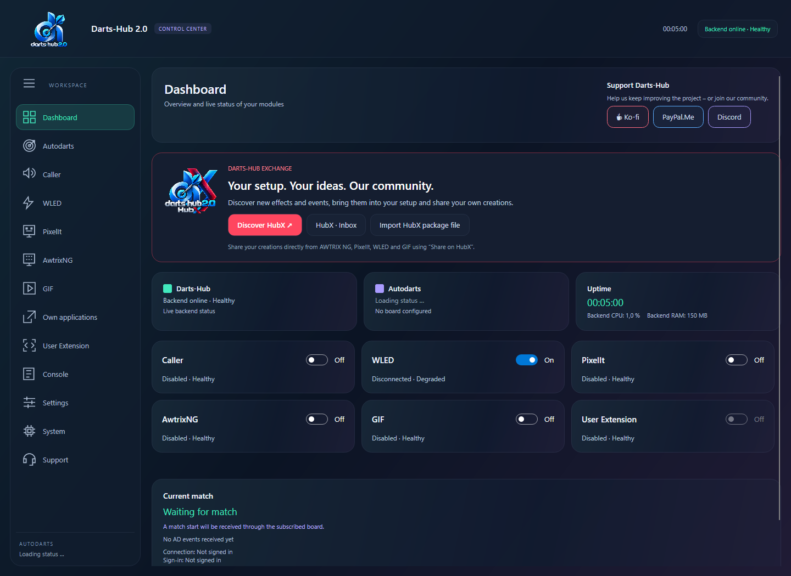

# Schnell einrichten / Quick setup

## Deutsch

1. Das passende Paket für Betriebssystem und x64/ARM64 installieren: [Installer](ONLINE_INSTALLER.md).
2. Darts-Hub öffnen oder im Programmordner `DartsHub --tui` starten. Linux/macOS verwenden `./DartsHub` beziehungsweise `./DartsHub.app/Contents/MacOS/DartsHub`.
3. Unter **Autodarts** die Board-ID eingeben, anmelden und den angezeigten Code im Browser bestätigen. Diese Anmeldung gilt für alle Erweiterungen.
4. Nur benötigte Erweiterungen aktivieren. Caller: Soundpack installieren und auswählen. WLED/Pixelit/AWTRIX: eigene Geräteadressen eintragen.
5. Änderungen **speichern**, dann eine Regel konfigurieren und testen. Die virtuelle Vorschau sendet nichts; die **Testsequenz** steuert das Gerät.
6. Unter [System](SYSTEM.md) den tatsächlichen Datenordner lokalisieren und sichern. Für Smartphone-Bedienung die [Weboberfläche](WEB_INTERFACE.md) einrichten.

## English

Install the matching OS/architecture package, open Darts-Hub or start `--tui`, sign in under **Autodarts** with your board ID and approve the code. Enable only the required modules, install/select a Caller soundpack, and enter device addresses. **Save** edits before testing. Virtual previews do not control hardware; device tests do. Locate and back up the actual data directory under **System**. See [web interface](WEB_INTERFACE.md) for phone access.

### Autodarts: Anmeldung und Wartezeiten / Sign-in and retry delays

GUI, TUI und Weboberfläche verwenden dieselbe gespeicherte Autodarts-Freigabe.
Bei vorübergehenden Fehlern wartet Darts-Hub vor weiteren Token-Erneuerungen
zunächst 30 Sekunden, danach zunehmend länger bis zu 15 Minuten. Längere vom
Server vorgegebene Wartezeiten werden eingehalten. Eine endgültig abgelehnte
Freigabe wird entfernt: Unter Autodarts erneut anmelden, in der TUI ebenfalls
über den Bereich Autodarts. Wiederholtes Klicken auf Verbinden verkürzt keine
laufende Wartefrist. Mehrere separat gestartete Installationen teilen diese
Wartefrist nicht; unnötige zusätzliche Instanzen schließen.

GUI, TUI and web interface reuse the same saved Autodarts authorization.
Temporary failures pause token refreshes for 30 seconds initially, increasing
up to 15 minutes; longer server-specified waiting periods are respected.
Rejected authorization is removed: sign in again through Autodarts in the GUI,
TUI or web interface. Repeatedly connecting does not shorten the waiting period.
Separate running installations do not share this deadline; close unnecessary
additional instances.
