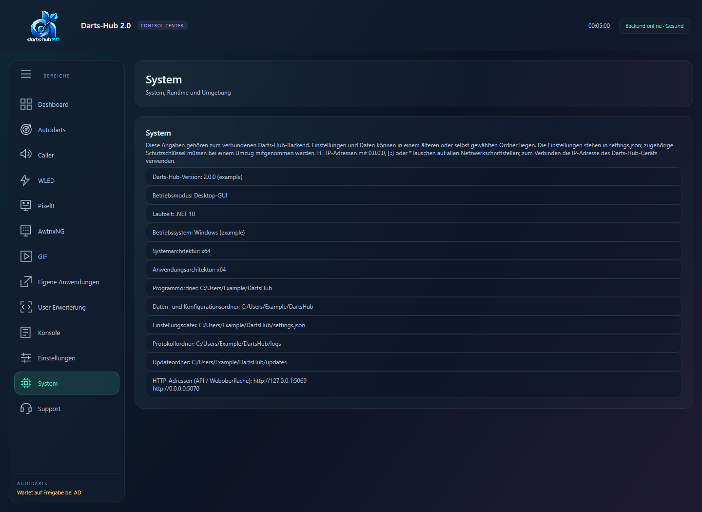
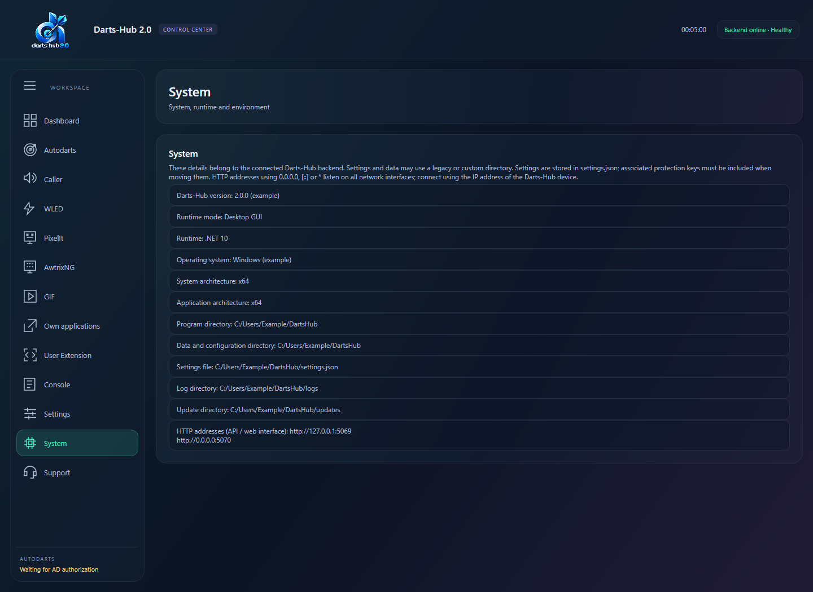

# Systeminformationen / System information

GUI: **System**. TUI: **Weitere Module / System → System**. Browser/Webapp: **System** im Seitenmenü.

Die Seite beschreibt den **verbundenen Backend-Rechner**, nicht das Smartphone: Darts-Hub-Version, Betriebsmodus, .NET-Laufzeit, Betriebssystem, beide Architekturen, Programmordner, Datenordner, konkrete `settings.json`, Protokollordner, Updateordner und tatsächlich gebundene HTTP-Adressen. Angaben lassen sich markieren und kopieren.

Eine vorhandene ältere Konfiguration oder ein eigener Datenpfad wird weiterverwendet. Der Datenordner muss daher nicht dem Programmordner entsprechen. Es werden keine angenommenen `./config`-/`./data`-Ordner oder fiktiven IPC-Adressen angezeigt.

Vor einem Umzug Darts-Hub beenden und den **gesamten Datenordner** einschließlich `settings.json` und `keys` sichern. Unter Windows sind geschützte Schlüssel zusätzlich an das Benutzerkonto gebunden. Externe Soundpack- und Vorlagenordner separat sichern. Update, Werkseinstellungen und vollständige Deinstallation sind unterschiedliche Aktionen.

`0.0.0.0`, `[::]` oder `*` bedeuten alle Netzwerkschnittstellen. Auf einem anderen Gerät die IP des Darts-Hub-Rechners und den angezeigten Port verwenden, nicht `localhost`. Für Internetzugriff die [gekoppelte Webapp](WEB_HTTPS.md) nutzen.

## English

Open **System** in the GUI/web app or **Other modules / system → System** in the TUI. The page describes the connected backend: version, runtime mode, runtime/OS, both architectures, actual program/data/log/update paths, settings file and HTTP listeners. Values can be selected and copied. Legacy or custom data paths can differ from the program directory.

Back up the entire data directory, including `settings.json` and `keys`, with Darts-Hub stopped. Windows protected keys are bound to the user account; separately back up external media. For remote access replace wildcard listener addresses with the host IP and use the actual port. `localhost` refers to the device you are using. Updates, factory reset and complete uninstall are different actions.

