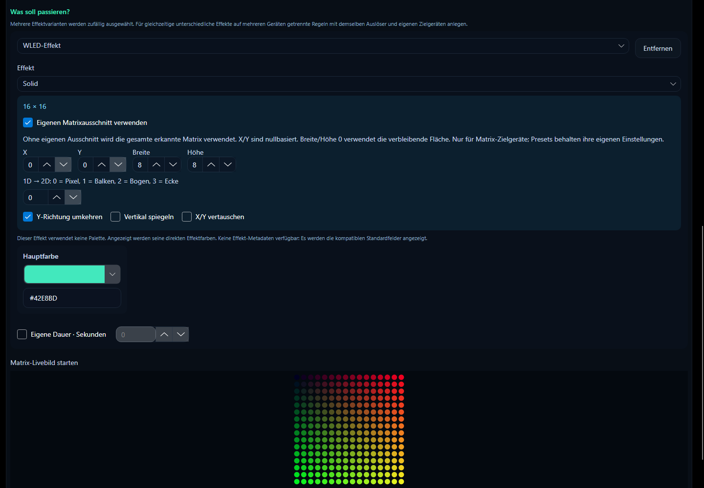
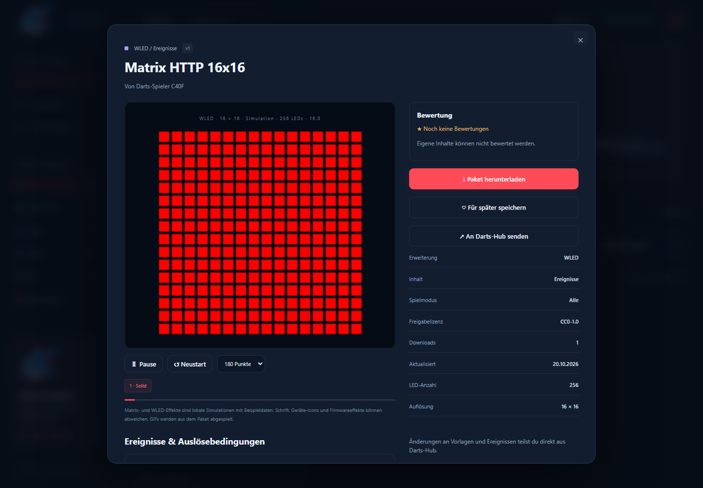
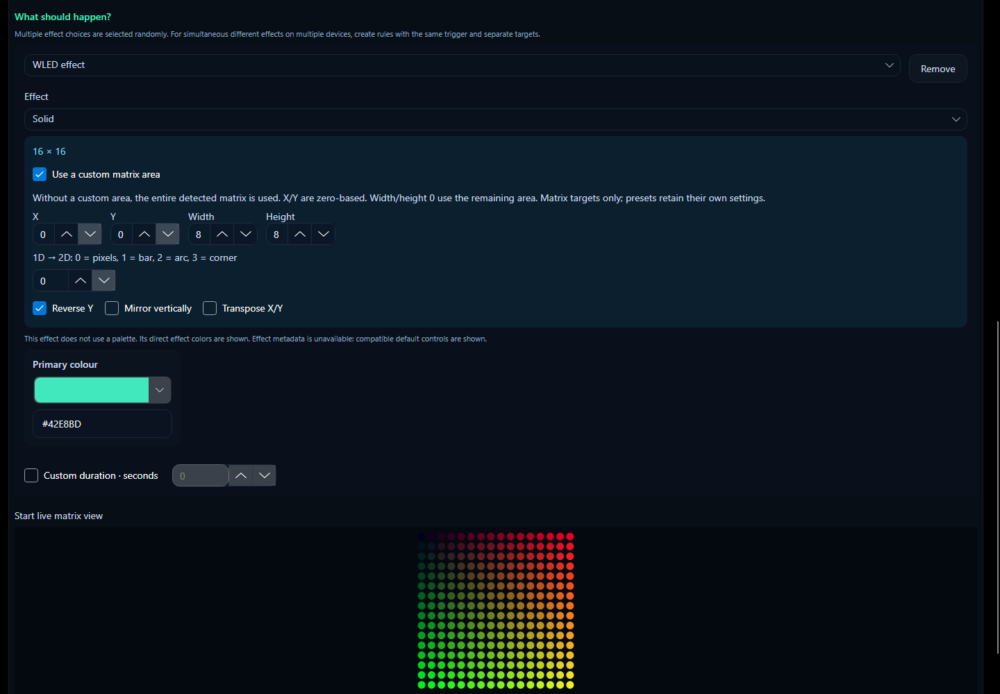
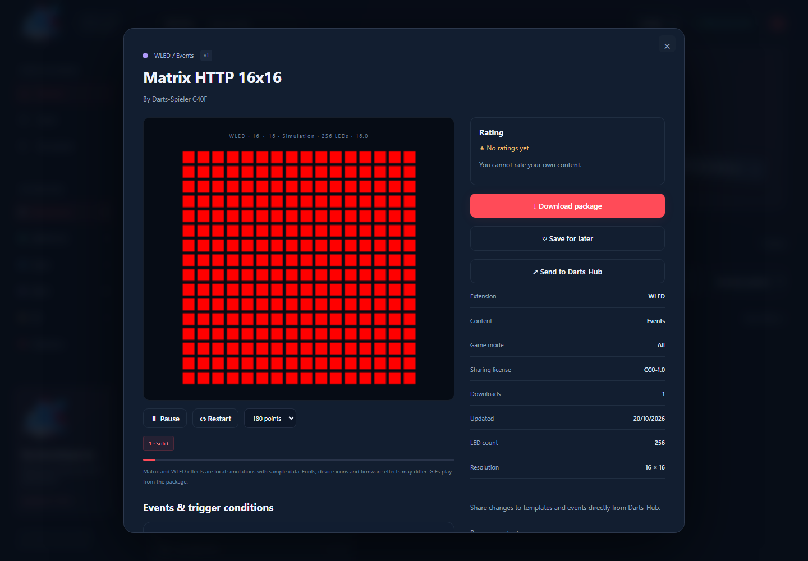
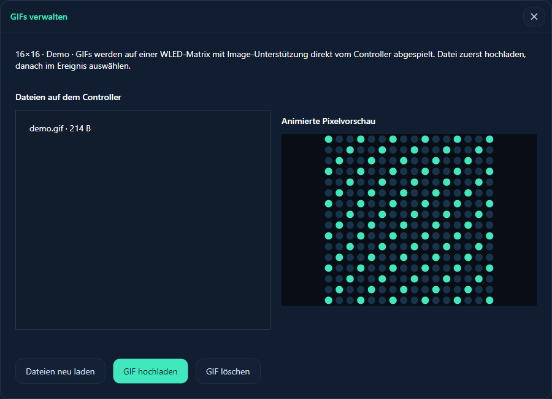
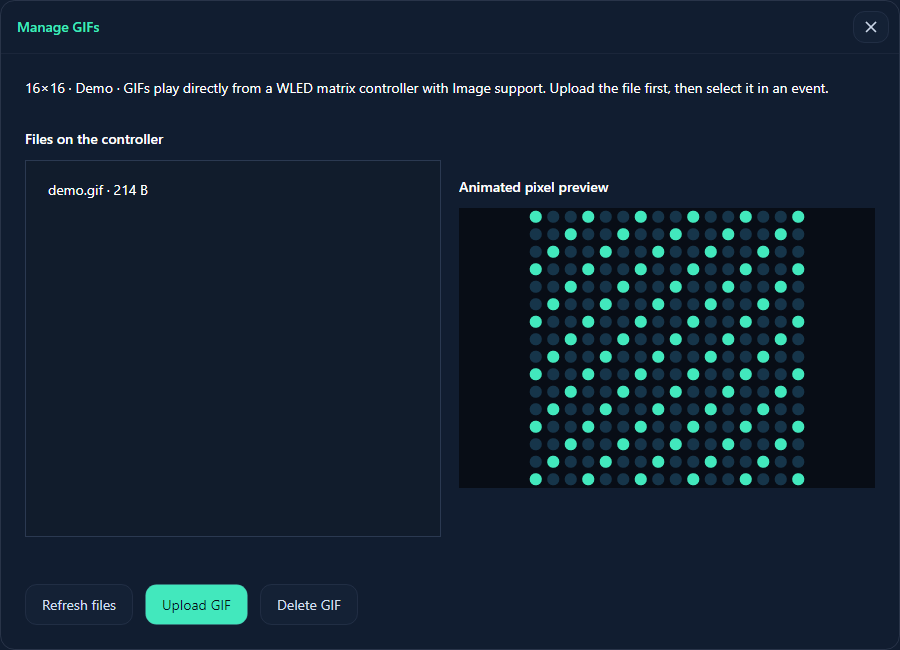
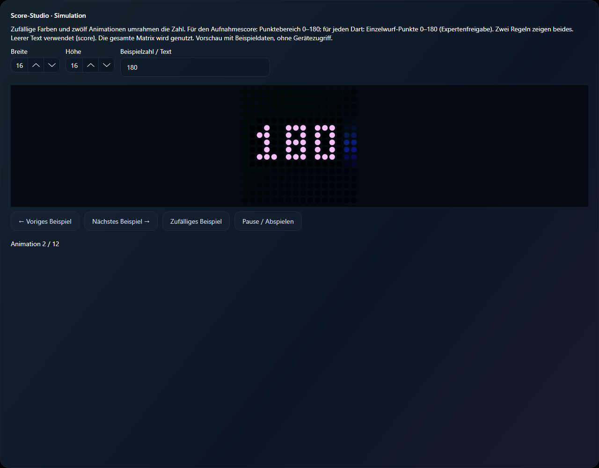
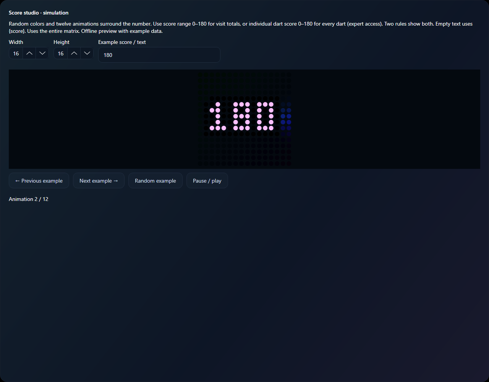
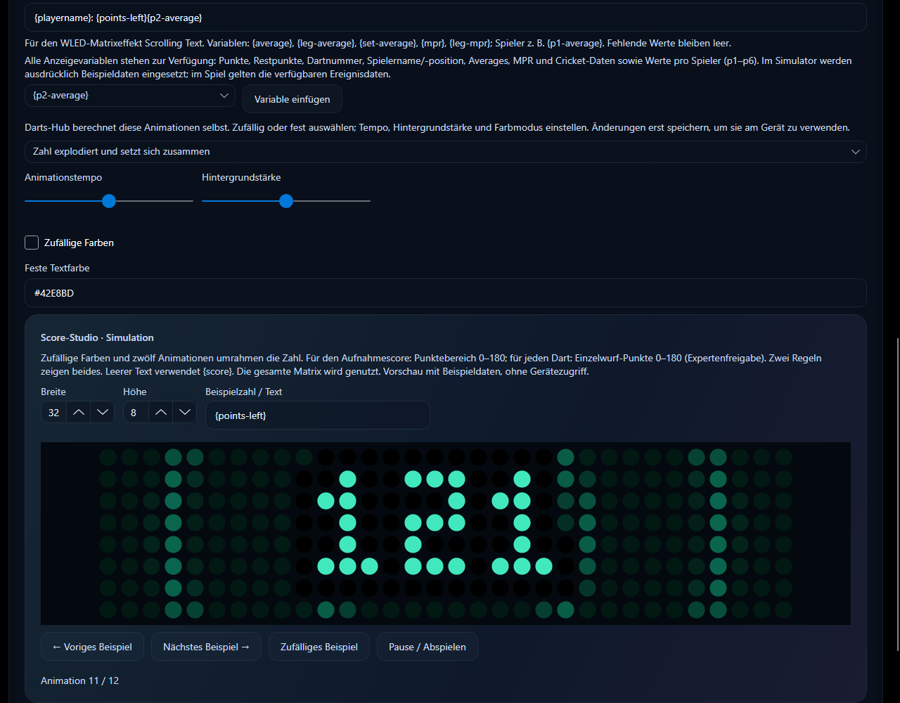
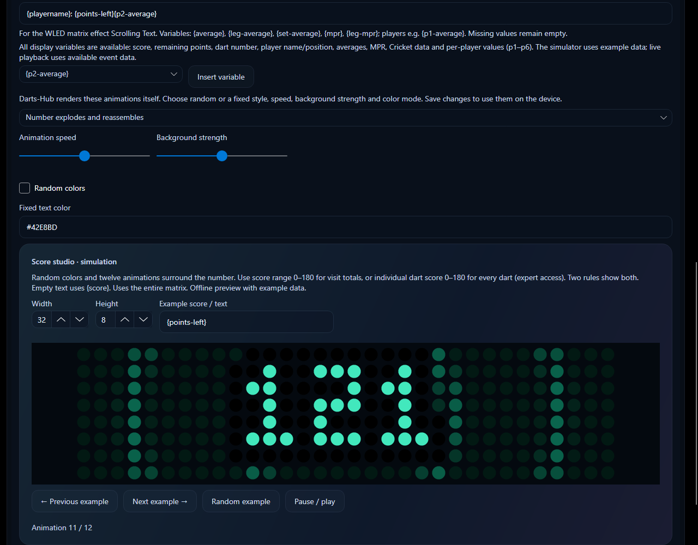

# WLED – Funktionsübersicht

## Geräte und Effektgestaltung

- Modul und einzelne Controller aktivieren; bis zu 32 Controller mit Namen, Adresse und optional eigener Helligkeit.
- Verbindung prüfen und echten Effekt-/Paletten-/Preset-Katalog manuell neu laden; Firmware, LED-Anzahl, Status und letzte Aktion sehen.
- Globale Helligkeit, Timeout, Standarddauer sowie Debug-/Protokollausgaben einstellen.
- Effekt oder Controller-Preset auswählen; mehrere Effektalternativen je Regel hinterlegen.
- Haupt-/Zweit-/Drittfarbe, Palette, Geschwindigkeit, Intensität und individuelle Dauer setzen; Palettenvorschau nutzen, soweit der Controller sie liefert.
- Preset-ID bleibt controllergebunden; ein Preset muss auf dem angesprochenen Controller vorhanden sein.
- Legacy-Palette auch ohne `p` importieren, z. B. `74|9`.

## Ereignisse und Automatik

- [Alle WLED-Regeltypen](EREIGNISSE.md): Aufnahme, DMU mit Feld/Ring, Multiplikator, Kombination, Gewinne, Spieler- und Boardereignisse.
- Zielgeräte, Spielername und bei geeigneten Ereignissen Spielerposition eingrenzen; Namen unabhängig von Schreibweise.
- Namensregel übersteuert allgemeinen gleichen Regeltyp pro Zielgerät.
- Bei gleichzeitig passenden Ereignissen: High Finish vor Matchgewinn, Spielgewinn, Bust, Cricket/Tactics-Trefferereignissen, Kombination, exaktem Score, Scorebereich, Feld, Multiplikator und übrigen Ereignissen. Danach zählt Regelspezifität; pro Gerät wird ein Effekt gewählt.
- Idle bei Match-/Legstart und im Spielablauf; Rückkehr nach begrenzten Effekten/Takeout. Dauer **0** bei Spielregeln bedeutet bis zum Takeout.
- Ausschalten bei Anwendungsstart bzw. nach Spielende; Schlaf-Effekt nach Inaktivität und optional späteres Ausschalten.
- **Match beendet und verlassen:** regulären Abschluss und Abbruch erfassen. Passende Exit-Regel übersteuert das automatische Ausschalten pro Zielgerät.
- Board vor Effekten kurz pausieren oder nach Gewinn stoppen; Board-Manager-Adresse einstellen bzw. aus Autodarts beziehen. Kein Caller nötig.

## Robbel3D One-Click

Gebündelten 145-LED-Ring und sechs Presets einrichten: Controller suchen, Adresse/GPIO, Board-ID und Medienordner wählen, Änderungen prüfen/bestätigen, Controller sichern, LED-Konfiguration/Presets übertragen, Ergebnis prüfen und Caller/WLED sofort anwenden. Sicherung als ZIP herunterladen. WLAN/Gerätekennung bleiben erhalten; weitere LED-Ausgänge werden deaktiviert und Presets ersetzt. GUI und TUI bieten denselben Ablauf.

## Grenzen

Feld, Multiplikator, Kombination, Schlaf, namensgebundenes Idle und Schlafparameter können die WLED-Lizenz benötigen. Ein gespeicherter gesperrter Wert umgeht sie nicht. Kataloge werden beim Start oder manuell geladen. Ein Vorschautest stellt den vorherigen Controllerzustand nicht automatisch wieder her. WLED-UDP-Synchronisation kann unabhängig angesprochene Controller gegenseitig überschreiben.

Weiterlesen: [Einrichtung](../WLED_CONFIGURATION_AND_AUTODARTS.md), [Robbel3D](../ROBBEL3D.md).

## Bedienung und Diagnose

GUI: Erweiterungsseite öffnen, Entwurf testen und speichern. TUI: `DartsHub --tui`, entsprechende Seite, **Enter** zum Bearbeiten und **Entwurf speichern**. Headless nutzt dieselbe Konfiguration. Vorschautests speichern nichts. Reale Statuswerte und Fehler stehen im Dashboard, auf der Modulseite und in der Konsole.

[Gemeinsame Funktionen](GEMEINSAM.md) · [Zur Übersicht](README.md)

## Cricket-Erweiterungen

Gewertete Marks, Feldabschlüsse, tatsächliche Punkte, nicht gewertete Treffer und entdeckte Hidden-Cricket/Tactics-Felder als Regeln auswählen. Dieselbe Auswertung gilt für Tactics, Standard, Cut Throat und No Score. Details und Terminal-Bedienung: [Ereignisse und Textvariablen](EREIGNISSE.md#cricket-tactics-und-hidden-cricket).

Die Cricket/Tactics-Auslöser reagieren bereits nach Dart 1 und Dart 2 und benötigen daher die Lizenzfreigabe `i_m_able_to_read`. Ohne Freigabe bleiben diese Regeln in GUI, TUI und bei der Ausführung gesperrt.

## LED-Matrizen / LED matrices

Beim Verbindungsaufbau liest Darts-Hub aus, ob WLED als Streifen oder 2D-Matrix eingerichtet ist. In der GUI wird nach Eingabe der Adresse und Verlassen des Feldes automatisch geprüft; in Weboberfläche und TUI lässt sich der Gerätekatalog laden. Die erkannte Matrix wird als Breite × Höhe angezeigt. Falls lesbar, erscheinen zusätzlich Panelgrößen und X/Y-Positionen. Die tatsächliche Verkabelung, Zickzack-Anordnung und eigene LED-Maps bleiben Aufgabe des Controllers: **Panelaufteilung in WLED konfigurieren** öffnet dessen 2D-Einstellungen. Danach den Gerätekatalog neu laden. Eine nicht erreichbare Konfiguration verhindert die grundlegende Matrixerkennung über die Geräteinformationen nicht.

Ist nur ein Matrixgerät verfügbar oder als Ereignisziel ausgewählt, erscheinen Matrixeinstellungen. Ohne eigenen Ausschnitt wird die gesamte Matrix genutzt. Mit eigenem Ausschnitt lassen sich X, Y, Breite, Höhe, vertikale Spiegelung und X/Y-Tausch festlegen. Koordinaten beginnen bei 0; Breite/Höhe 0 reichen bis zum Rand. Ein Ausschnitt muss auf jedes ausgewählte Ziel passen. 2D-Effekte werden anhand der Controller-Metadaten von reinen Streifengeräten unterschieden. Presets behalten ihre eigene Segmentkonfiguration.

**Matrix-Livebild starten** liest für einen kurzen Zeitraum die tatsächliche WLED-Ausgabe aus. Bei genau einem Matrixziel zeigt auch **Test-Sequenz** das Controllerbild. Die TUI bietet ein lesbares Standbild unter WLED → Gerät → Matrix-Livebild sowie dieselben Ausschnitte im Konfigurationseditor unter Effekte → Matrix. Die Weboberfläche und gekoppelte Webapp verwenden denselben Backendzugriff. WLED unterstützt nur einen Peek-Empfänger gleichzeitig und kann größere Matrizen herunterrechnen; daher können andere Peek-Fenster währenddessen pausieren.

In HubX werden Matrixvorlagen als Matrix und nicht als Dartboard-/Wandbeleuchtung dargestellt. Verfügbare Filter umfassen 8×8, 16×16, 32×8, 64×8, 32×16, 32×32, 16×8 und Hochkantvarianten. Das sind **Breite × Höhe**, nicht Höhe × Breite. Controlleraufnahmen geben dessen Effekt wieder; ohne Aufnahme werden unbekannte Firmwareeffekte ausdrücklich nicht als exakte Simulation ausgegeben. Volle Aufnahmen sind weiterhin auf maximal 1024 LEDs begrenzt. Matrixpakete verwenden Paketversion 3; HubX und Darts-Hub müssen entsprechend aktuell sein. Ein Import auf ein reines Streifengerät wird abgewiesen. Die Zielverkabelung wird niemals vom fremden Gerät übernommen.

Darts-Hub detects strip versus 2D matrix when connecting. GUI address completion triggers detection; web and terminal users can load the device catalog. Dimensions are **width × height**. Readable panel configuration adds panel sizes and X/Y positions. Configure physical wiring, serpentine layout and custom LED maps through **Configure panel layout in WLED**, then reload the catalog. Matrix detection remains available if the detailed configuration is protected.

Matrix-only event targets expose optional X/Y areas, width/height, reverse Y, mirror Y and transpose. By default the whole matrix is used. Zero width/height extends to the corresponding edge. Areas must fit every target; presets keep their own segments. The controller live view shows real output; the TUI offers a readable snapshot and the same area settings under effects → Matrix. Web UI and webapp use the same backend. WLED Peek allows one receiving client at a time and may downsample larger matrices.

HubX renders matrices at their actual aspect ratio, offers resolution filters in both orientations and retains dimensions on downloads and direct imports. Exact firmware animation requires a controller recording; unavailable firmware previews are labeled accordingly. Full recordings remain limited to 1024 LEDs. Matrix packages require schema version 3 and current HubX/Darts-Hub versions. Imports reject strip-only targets and never overwrite their wiring configuration.

Native WLED-Effekte, Presets und GIF-Dateien vom Controller werden unterstützt. GIFs werden einmal hochgeladen und anschließend vom Controller wiedergegeben. / Native effects, presets and controller GIF files are supported. GIFs upload once and then play on the controller.

Die 1D→2D-Abbildung ist pro Ausschnitt wählbar: 0 Pixel, 1 Balken, 2 Bogen, 3 Ecke. / Per-area 1D→2D mapping supports 0 pixels, 1 bar, 2 arc and 3 corner.

### Bilder zur Einrichtung und HubX-Vorschau

Die folgenden Aufnahmen zeigen die echte Oberfläche mit **synthetischen 16×16-Beispieldaten**. Sie sind keine Aufnahme eines angeschlossenen Controllers. Die Einrichtung, Ausschnittwahl und Darstellung lassen sich damit nachvollziehen.

### Setup and HubX preview screenshots

These screenshots show the actual interface with **synthetic 16×16 sample data**, rather than a recording from a connected controller. They illustrate area configuration and matrix presentation.

## GIFs auf einer WLED-Matrix

1. Das Gerät einrichten und den Katalog laden. Benötigt wird eine erreichbare Matrix mit **Image**-Effekt, üblicherweise geeignete ESP32-Firmware ab WLED 16. ESP8266 unterstützt diese Wiedergabe nicht.
2. Beim Gerät **GIFs verwalten** öffnen. Vorhandene Dateien erscheinen mit Name und Dateigröße. Ein Klick zeigt eine animierte Pixelvorschau. **GIF hochladen** lädt eine lokale Datei; **GIF löschen** entfernt die ausgewählte Datei nach Bestätigung sofort vom Controller.
3. In einer Ereignisregel **GIF vom Controller** wählen und den vollständigen GIF-Dateinamen einschließlich `.gif` auswählen. Der Katalog kann nach manuellen Änderungen außerhalb von Darts-Hub erneut geladen werden. Ein eigener Matrixausschnitt ist weiterhin möglich. Die vorhandene Effektdauer und Rückkehr zu Idle gelten auch für GIFs.
4. Beim **Teilen auf HubX** wird die verwendete GIF-Datei direkt aus dem Quellcontroller mitgenommen. Dies gilt auch für Image-Segmente in einem verknüpften Preset. Beim Import über Senden oder Paketdatei werden Dateien und Presets geprüft und die Verweise angepasst. Bei gleichnamigen Dateien lässt sich Überschreiben oder Umbenennen wählen; zwischenzeitlich veränderte Dateien verhindern ein unbemerktes Überschreiben. Auch ein einzelnes HubX-GIF lässt sich ohne neue Ereignisregel auf WLED laden.

GIFs müssen bereits auf die Matrix passen (maximal 128×128 und 4 MiB). Dateinamen sind auf 31 Zeichen beschränkt und erlauben Buchstaben A–Z, Zahlen, Bindestrich, Unterstrich und Punkt. Es erfolgt keine automatische Verkleinerung. Freier Speicher und tatsächliche Wiedergabeleistung hängen vom Controller ab. Die GUI-Vorschau ist begrenzt auf 600 Frames; sehr lange Animationen können diese Vorschaugrenze überschreiten. HubX nutzt für GIF-Vorschauen seine begrenzte Bilddecodierung. WLED spielt die Datei eigenständig ab; Darts-Hub überträgt keine laufenden Einzelbilder.

**Terminal:** `DartsHub --tui` → WLED → Gerät → **GIFs verwalten** zum Auflisten, Hochladen oder Löschen. In der Ereigniskonfiguration unter Effekte den Typ **GIF vom Controller** und den Dateinamen wählen. Die lokale Weboberfläche und gekoppelte Webapp bieten dieselben Dateiaktionen und Importprüfungen.

## GIF playback on a WLED matrix

Configure the matrix and reload its catalog. A supported ESP32 firmware with the **Image** effect (normally WLED 16+) is required; ESP8266 cannot play these GIFs. Open **Manage GIFs** beside the device to list files, preview a selected animation, upload a local GIF or confirm deletion. Choose **GIF from controller** in an event and select its complete filename. Existing duration and idle-return behavior also apply.

HubX sharing reads referenced GIF files from the source controller, including Image segments inside presets. Direct delivery and package-file imports review conflicts, upload the selected files and update their references. Rename or explicitly overwrite collisions; concurrent file changes invalidate an overwrite decision. Standalone HubX GIFs can upload to WLED without creating an event.

Files must fit the target matrix: up to 128×128, 4 MiB, 2000 frames and a 31-character safe filename. There is no automatic resizing. Controller storage and playback performance vary. GUI previews have a 600-frame budget; HubX also bounds preview decoding. Playback runs on WLED itself rather than streaming frames from Darts-Hub. Terminal users open `DartsHub --tui` → WLED → device → **Manage GIFs**; event configuration exposes the same GIF type and filename. Local web UI and webapp share these operations and import checks.

### GIF-Verwaltung / GIF manager

Echte GUI mit synthetischen 16×16-Beispieldaten. / Actual GUI with synthetic 16×16 sample data.

### Eine GIF-Datei fehlt in der Liste / A GIF is missing from the list

32×32 ist eine unterstützte Größe; `Busted_32x32.gif` ist ein gültiger Dateiname. Darts-Hub liest die aktuelle Dateiliste und verwendet bei einer leeren Antwort oder einem nicht verfügbaren Endpunkt zusätzlich die ältere Abfrage. Bei einer weiterhin leeren Liste unter WLED 16.0.1 die Antwort von `http://<WLED-IP>/edit?list=/` prüfen. Die Anfrage liest nur die Dateiliste. Für die Fehlersuche Firmwareversion, genaue Meldung und diese JSON-Antwort bereitstellen. Die WLED-Konsole protokolliert die Antwort auf das Einlesen der Liste; GIF-Dateiinhalte werden nicht protokolliert. Derselbe Zugriff gilt in GUI, TUI, Weboberfläche und Webapp.

32×32 is supported and `Busted_32x32.gif` is a valid filename. Darts-Hub tries the current file-list request and falls back to the legacy endpoint if the result is empty or the endpoint is unavailable. If the list remains empty on WLED 16.0.1, inspect `http://<WLED-IP>/edit?list=/`. This only reads the file list. Provide firmware version, the exact message and the returned JSON for investigation. WLED console diagnostics include the retrieved file list, not GIF file contents. GUI, TUI, web UI and webapp share this backend access.

## Animierter Matrix-Score / Animated matrix score

In einer Ereignisregel unter **Was soll passieren? → Matrix · animierter Score** auswählen. Leerer Text zeigt `{score}`. **Punktebereich 0–180** zeigt den Aufnahmescore nach den Würfen; **Einzelwurf-Punkte 0–180** zeigt jeden Dart (WLED-Expertenfreigabe `im_able_to_read`). Für beides zwei Regeln anlegen. Andere Auslöser und deren Priorität bleiben gültig: z. B. kann ein Siegeffekt die Score-Anzeige ersetzen. Der Score ist die Punktzahl des Ereignisses, nicht automatisch der Restscore. Für Restpunkte kann beispielsweise `{points-left}` verwendet werden.

Zwölf Hintergrundanimationen mit zufälligen Farben werden bei jeder Auslösung neu gewählt. Der Text bleibt mit dunklem Rand lesbar. Die volle, auf dem Controller konfigurierte Matrix wird verwendet: 1–128 Spalten, 5–128 Zeilen. Kleine Breiten scrollen; mindestens 11×5 für drei Ziffern wird empfohlen. Eigene Matrixausschnitte sind für diese Effektart nicht vorgesehen. Für Streifen wird keine Score-Animation gesendet.

Das **Score-Studio** in der Effektkarte zeigt synthetische Beispieldaten mit derselben Bildberechnung wie auf dem Gerät. Breite, Höhe und Beispielzahl sind frei veränderbar; **Voriges/Nächstes/Zufälliges Beispiel** wechseln das Muster. Diese Werte ändern keine Geräteeinstellungen. Die Vorschau funktioniert offline. Im Terminal: `DartsHub --tui` → WLED → Konfiguration → **Score-Studio · Simulation**. Dieselben Effektfelder und eine animierte Simulation gibt es in lokaler Weboberfläche und Webapp. Die native mobile App kann Effekt und Text konfigurieren; der Simulator ist dort noch nicht nativ integriert.

Die Bilder werden mit maximal 10 Bildern/s über WLEDs individuelle Pixelsteuerung übertragen. Große Matrizen/langsame Controller können weniger Bilder/s erreichen; es werden keine Bilder aufgestaut. Die Bilder werden nicht als GIF auf den Flash geschrieben. Das nächste Ereignis, Idle, Ausschalten oder Beenden löst die Anzeige ab. Dauer 0 folgt wie gewohnt dem nächsten Ereignis, eine eigene Dauer kann zur Idle-Anzeige zurückkehren. HubX-Teilen erfordert **Controller-Vorschau aufnehmen**, damit die Vorschau eine echte Beispielaufnahme zeigt. Dateiimport und direkte Zustellung erhalten Effektart und Text; beim Import wird eine geeignete Zielmatrix geprüft.

Choose **Matrix · animated score** as an event action. Empty text uses `{score}`. **Score range 0–180** displays a completed visit; **Individual dart score 0–180** displays each dart (WLED expert feature `im_able_to_read`). Configure two rules for both. Existing priorities still apply, so a winning effect may replace the score display. This is the event score, not automatically the remaining score; `{points-left}` can display remaining points.

Twelve random background styles and colors frame the legible text. Uses the entire configured controller matrix, 1–128 columns and 5–128 rows; narrow matrices scroll. At least 11×5 is recommended for three digits. Custom matrix areas and strips are not supported by this action.

**Score studio** lets you change offline example dimensions and text and browse previous/next/random animations. Its renderer is shared with hardware playback; preview dimensions do not configure the device. Terminal: `DartsHub --tui` → WLED → Configuration → **Score studio · simulation**. Local web UI/webapp provide the same action and simulator; native mobile configuration supports effect/text, but has no native simulator yet.

Playback streams at up to 10 fps without writing GIFs to flash. Large matrices or slower controllers may reduce the rate; frames never accumulate. The next event/idle/off/shutdown cancels playback. Duration 0 continues until replaced; a custom duration can return to idle. Sharing on HubX requires **Record controller preview**. File import and direct delivery preserve the action/text and check the target matrix.

Actual desktop controls with synthetic example scores / Echte Oberfläche mit synthetischen Beispielzahlen:

### Animationen und Variablen einstellen / Configure animations and variables

Die Animationen werden von Darts-Hub selbst berechnet und gestreamt. Sie sind keine Nachbildungen oder zusätzlich freigeschalteten Effekte aus der WLED-Firmware. Verfügbar: Wellenringe, Radar, Funkeln, diagonale Wellen, Regen, vollflächiges Plasma, Feuer, Polarlicht, kreisende und springende Zahl, Explosion und Implosion. Explosion/Implosion zerlegen bzw. verdichten die Textpixel und setzen die Anzeige zyklisch wieder lesbar zusammen. Auf kleinen Matrizen ist der Bewegungsspielraum begrenzt.

Im Ereignis: **Zufällig** oder eine feste Animation wählen, **Animationstempo**, **Hintergrundstärke** und **zufällige Farben / feste Textfarbe** einstellen. Die Hintergrundstärke verändert nicht die Gerätehelligkeit. Eine Stärke von 0 blendet nur den Hintergrund aus. Im Score-Studio wirken diese Werte ebenfalls; das Durchklicken verändert die gespeicherte Effektwahl nicht. Im Terminal den Score-Studio-Button innerhalb des geöffneten MatrixScore-Effekts verwenden, um dessen Einstellungen als Ausgangspunkt zu nutzen. Die Terminalvorschau stellt Helligkeiten monochrom dar.

Über **Variable einfügen** stehen sämtliche gemeinsamen Anzeigevariablen zur Auswahl. Beispiele: `{score}`, `{dart-score}`, `{turn-score}`, `{points-left}`, `{dart-number}`, `{darts-thrown}`, `{playername}`, `{player-number}`, `{average}`, `{leg-average}`, `{set-average}`, `{mpr}`, `{leg-mpr}`, `{game-mode}`, `{game-mode-extra}`, `{cricket-scoring-mode}`, `{cricket-field}`, `{cricket-marks}`, `{cricket-turn-marks}`. Spielerbezogen stehen für `p1` bis `p6` die Endungen `average`, `leg-average`, `set-average`, `mpr`, `leg-mpr`, `playername`, `points-left`, `darts-thrown`, `dart-number`, `dart-score`, `turn-score` bereit, etwa `{p2-average}`. Die Liste kommt aus demselben Katalog wie Pixelit/AWTRIX. Nicht verfügbare Ereigniswerte bleiben leer; der Simulator verwendet gekennzeichnete Beispieldaten. Namen werden in der Pixel-Schrift großgeschrieben; Umlaute werden als AE/OE/UE dargestellt.

Darts-Hub renders and streams these animations itself; these are not WLED firmware effects. Choose Ripple, Radar, Sparkles, diagonal Waves, Rain, full-matrix Plasma/Fire/Aurora, Orbit, Bounce, Explosion or Implosion. Explosion/Implosion scatter or compress the text pixels, then reassemble the readable value in a cycle. Movement space is limited on small matrices.

Select random or a fixed style, animation speed, background strength and random colors or a fixed text color. Background strength does not change device brightness; 0 hides the background only. The studio uses these settings; browsing examples does not change the saved style. In the terminal open the studio from inside a MatrixScore effect to use its settings (monochrome brightness preview).

**Insert variable** exposes the complete shared display-variable catalog, including scores, remaining points, player names/numbers, dart counts, averages, MPR, game/Cricket fields and player-specific values for `p1`–`p6`. Examples: `{playername}: {points-left}`, `AVG {p2-average}`, `{dart-score}`. All keys and player suffixes are listed above; unavailable event data resolves to empty text. The studio substitutes example data. Pixel text uses uppercase Latin characters with diacritic transliteration.

